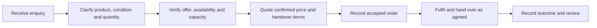
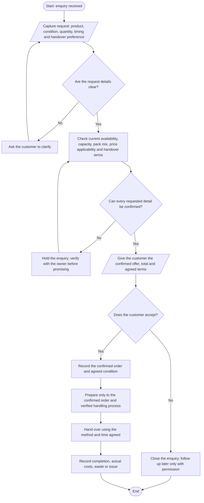
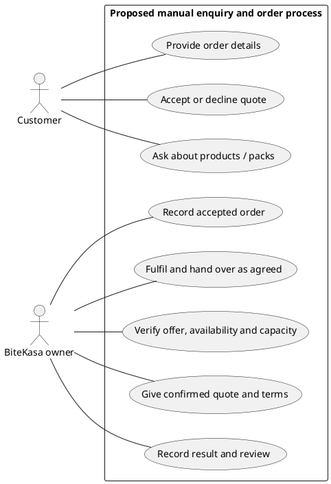
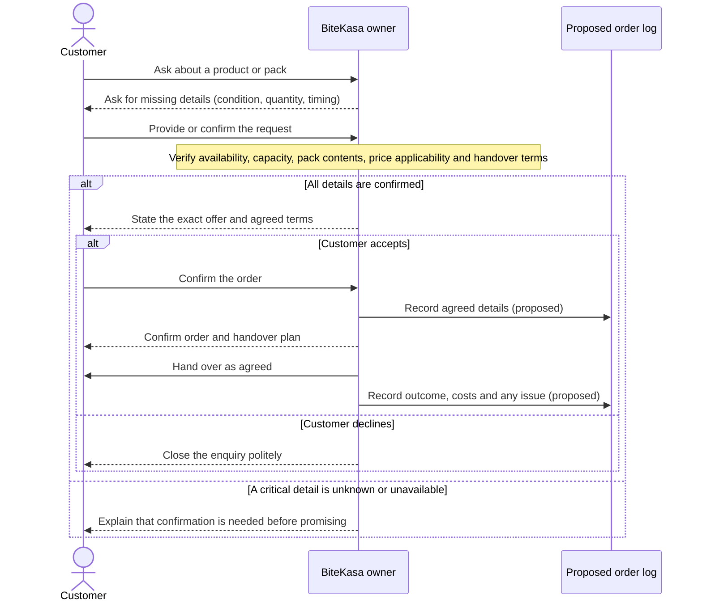

# BiteKasa — proposed enquiry-to-fulfilment workflow

**Status: working proposal, not an owner-confirmed operating procedure.** It translates the supplied flowchart, activity-diagram, process-flow, sequence-diagram and use-case references into a cautious first version for BiteKasa. It does not assert that any step is already used, that stock is available, or that pickup, delivery, payment, storage or preparation arrangements have been decided.

## Evidence boundary

**Known from the accessible shared chats:** BiteKasa sells samosas and spring rolls; products may be fried, unfried, or rolled and frozen before frying; current sales are through the owner’s church and home; the advertised offers are Silver (GH₵100 / 30 pieces), Golden (GH₵200 / 50 pieces + 500 ml Coca-Cola), and Premium (GH₵250 / 70 pieces + 1 litre Coca-Cola). The exact product split and which product conditions the pack prices cover are not stated. Contact numbers and WhatsApp status require owner confirmation.

**Everything below is a proposed control:** qualify an enquiry, verify uncertain details before promising, record accepted orders and actual outcomes, and use measured results to improve the process. Owner confirmation is required before treating this as the business’s real workflow.

## 1. High-level process map

This uses the supplied two-shape process-map idea: each box is a major process, and arrows show sequence. It intentionally does not show decisions or claim the current internal arrangement.

## 2. Detailed proposed order flow

The flowchart expands the major processes into actions and decisions. A decision path that depends on unknown information pauses for confirmation instead of guessing.

**Guardrails for using the flow:**
- “Check current availability, capacity, pack mix, price applicability and handover terms” is a proposed confirmation step. The current stock, capacity, product split, prices by condition, service area, pickup/delivery, timing and payment terms are unknown.
- “Prepare” and “hand over” describe a future agreed order only; they do not imply an established food-safety process, delivery service or storage guidance. Confirm applicable food handling with a competent local source before publishing instructions.
- Do not ask for or record unnecessary personal data. Keep any order record access-controlled and obtain permission before marketing follow-up or publishing customer feedback.

## 3. Proposed use-case scope

This is a **manual business workflow**, not a specification for a website or app. Keep actors outside the boundary and use cases inside it. UML does not require “input” actors on the left and “receiver” actors on the right; place actors wherever the diagram reads clearly. Actor associations normally show participation, not message direction.

## 4. Example enquiry sequence

The vertical order represents time. The “Order log” participant is a **proposed manual record**, not an existing system.

## 5. Minimum proposed order record

Use only fields needed to run the order and understand the business. Leave unknown values blank until confirmed.

| Field | Why it matters | Status |
|---|---|---|
| Date/reference and enquiry source | Trace the transaction and compare channels | Proposed recordkeeping |
| Product and condition (fried / unfried / frozen) | Avoid mismatched preparation expectations | Confirm availability for each order |
| Quantity and exact samosa/spring-roll mix | Prevent ambiguity; the current pack mix is unknown | Confirm before accepting |
| Pack, price, included drink and applicability to condition | Ensure the customer sees the full offer and total | Confirm before quoting |
| Agreed timing and handover method/location | Avoid promising unconfirmed collection or delivery | Owner must define |
| Payment terms/status | Reconcile cash and order completion | Method and terms unknown; owner must define |
| Actual variable costs, waste, issue/refund and completion | Learn contribution and reliability from evidence | Measure; do not call contribution net profit |
| Feedback / marketing consent | Separate service feedback from permission to contact later | Ask permission; store minimally |

## 6. Owner decisions needed before this becomes an SOP

1. Confirm the current pack contents, product mix, formats offered and whether the three listed prices apply to each condition.
2. Define how availability and production capacity are checked, and what order lead times the owner can reliably support.
3. Confirm collection/delivery options, service area, handover times and any related charges—or state that these are not offered.
4. Confirm accepted payment methods, when payment is due, and how payment status is recorded.
5. Verify both phone numbers and whether either is an active WhatsApp Business contact.
6. Confirm truthful storage/preparation instructions and the appropriate local food-safety requirements before making customer-facing claims.
7. Approve the illustrative flyer image or provide an actual product photograph.

## 7. What to measure first

Start with a baseline rather than guessed targets: enquiries received, quotes issued, accepted orders, completed orders, repeat orders, mix by product/condition/channel, contribution based on measured variable costs, waste, late/missed handovers and order issues. Record the denominator for any conversion rate. Use the results to decide whether a small nearby customer test is operationally sensible before adding overhead.

## Diagram-source interpretation

- The six-shape flowchart reference is a useful simple teaching subset (terminator, process, decision, input/output, connector and flow arrow), not a complete notation for every process.
- The two-shape rectangle-and-arrow process map is useful for high-level stages; its strict left-to-right rule is a layout convention from that guide, not a universal process-modeling law. It cannot express branches by itself.
- Activity diagrams are useful for responsibility lanes and branching; use a fork/join only when work truly occurs in parallel. Do not force parallelism into this order flow.
- Sequence diagrams express interaction order and message exchange, not business-policy truth.
- Use-case diagrams show actors, system scope and goals; they do not prescribe actor placement or replace a detailed activity/process flow.
- These uploaded guides contain simplified and repeated teaching rules. This workflow applies their useful modeling concepts while treating notation preferences as conventions and keeping all BiteKasa operating assumptions visibly provisional.
