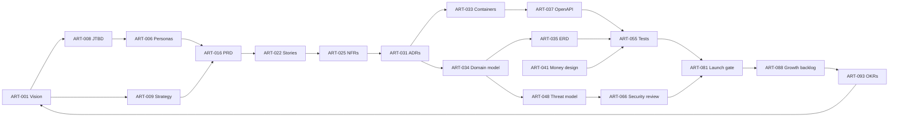

# 02 — The SDLC Framework: 8 Cells, 7 Gates, One Evidence Chain

> This is the operating system for the whole project. It answers: *who does what, with which
> artefact, proven how, before what is allowed to happen next.* It is deliberately heavier than
> a startup "needs", so that the tailoring table in §2.10 can cut it down with intent instead of
> cutting it down by accident.

---

## 2.1 Why cells, not phases

A waterfall phase ends when a document is signed. An agile sprint ends when the increment is
demoed. Neither is a good model for a two-sided marketplace where the expensive failures are
**cross-cutting**: a refund flow that ignores the ledger, a ranking model that ignores the
dispute data, a launch that ignores the DPC registration.

So the model has two axes:

- **8 cells** — stable areas of responsibility, each with an owner, an exit gate and a set of
  artefacts (ART-###). Cells run in parallel and loop; they do not "end".
- **7 gates** — irreversible-enough checkpoints where evidence is inspected and someone with a
  name says *go* or *no-go*.

```
Discover ─▶ Define ─▶ Architect ─▶ Build ─▶ Assure ─▶ Secure ─▶ Deploy ─▶ Sustain
    ▲           │          │          │        │         │         │          │
    └───────────┴──────────┴──────────┴────────┴─────────┴─────────┴──────────┘
                        (every cell feeds Sustain; Sustain feeds Discover)
```

| Cell | The question it answers | Accountable (from `01-role-catalog.md`) | Artefacts |
| --- | --- | --- | ---: |
| **Discover** | Is this worth building, for whom, and is it true? | Founder/CEO (D001), Head of Product (D003) | 15 |
| **Define** | What exactly, for which actor, under which rule? | Product Manager (D031), BA (D033) | 12 |
| **Architect** | How will it be structured so it survives contact with reality? | Solution Architect (D061), Domain Lead (D070) | 12 |
| **Build** | Make it real, in small reversible increments. | Tech Lead (D119), DevEx Lead (D113) | 8 |
| **Assure** | How do we know it works — including when it is attacked or starved? | QA Lead (D121) | 14 |
| **Secure** | What can go wrong, who would do it, and what stops them? | Security Architect (D068), CISO-equivalent (D187) | 12 |
| **Deploy** | How does it reach users safely and come back if it does not? | Release Manager (D095), SRE (D092) | 14 |
| **Sustain** | Is it still working, still wanted, and still affordable? | COO (D005), Head of Product (D003) | 23 |

Counts are regenerated from `tools/data/artifacts.yaml`; see `STATUS.md` for the live total.

---

## 2.2 Gates (the only place the project is allowed to say "go")

A gate is not a meeting. It is a **checklist with evidence links**, reviewed asynchronously by
the named accountable person, and recorded in the decision log. If the evidence is not linked,
the gate fails by default. This is the cheapest possible defence against optimism.

| Gate | Between | Entry evidence (must be linked) | Decision owner | Fails if |
| --- | --- | --- | --- | --- |
| **G0 Problem** | Discover → Define | ART-001, ART-008 (≥12 interviews), ART-015 | D001 | the pain is inferred, not observed |
| **G1 Scope** | Define → Architect | ART-016, ART-022, ART-025, ART-021 | D003 | NFRs are adjectives; roles are undefined |
| **G2 Design** | Architect → Build | ART-033, ART-034, ART-037, ART-048, ART-041 | D002 | money/trust paths are undesigned |
| **G3 Ready** | Build entry (per epic) | ART-026 (DoR), ART-055 outline | D031 | no acceptance criteria, no test approach |
| **G4 Verification** | Assure → Secure | ART-054 executed, ART-101, ART-104 | D121 | critical paths untested; no performance evidence |
| **G5 Security** | Secure → Deploy | ART-048 updated, ART-066, ART-067, ART-068 (mobile) | D187 | any critical/high finding open without written risk acceptance |
| **G6 Launch** | Deploy → Sustain | ART-081, ART-074 (restore proven), ART-062, ART-070 | D005 | rollback unproven; compliance evidence missing |
| **G7 Review** | Sustain → next Discover | ART-093, ART-086, ART-088 | D001 | no metric movement, no honest accounting of cost |

**Rule G-1 (evidence over assertion).** "It works" is not evidence. A test run, a dashboard, a
signed certificate, or a dated log is evidence. This single rule prevents most of the paperwork
culture people fear from process: artefacts are kept *because* they are the cheapest form of proof.

---

## 2.3 Discover — is it true?

**Purpose:** replace belief with evidence, cheaply and fast.

| Artefact | Owner | What "good" looks like |
| --- | --- | --- |
| ART-001 Vision & Mission Canvas | D001 | One page. A stranger can repeat the promise back to you. |
| ART-002/003 Lean & Business Model Canvas | D004 | Every "unfair advantage" is either evidence or an `H-###` hypothesis. |
| ART-004 Market Sizing | D006 | Bottom-up: `# of firms × % hiring tech × avg annual spend`. Every input cited or labelled. |
| ART-005 Competitive Matrix | D007 | ≥8 comparables; columns are facts a buyer could verify (price, escrow, KYC, payout rails). |
| ART-006 Personas | D009 | Built from quotes, not from imagination; ≥3 per side. |
| ART-008 JTBD + interviews | D010 | ≥12 documented interviews; notes retained (the raw notes are the asset). |
| ART-010 NSM & KPI tree | D003 | One North Star, three inputs, all computable from the event log. |
| ART-011 Unit economics | D021 | Contribution margin per completed job, before and after provider fees. |
| ART-013 Regulatory map | D018 | Act 843 registration, payment licensing position, store policy, labour classification. |
| ART-015 Evidence log | D030 | Each load-bearing assumption has a test, a result and a verdict. |

**Common failure modes (all observed in real startups):** sizing from a headline number; treating
"tech unemployment" as demand; interviewing only people who look like the founders; writing the
canvas after the product instead of before.

**AI in this cell:** interview transcription and clustering, competitor review mining, first-draft
models. AI is *not* allowed to produce a quote, a customer, or a market fact. Every AI-generated
number is a hypothesis until a human attaches a source.

**Exit gate G0:** 12 interviews, three persona archetypes, one falsifiable NSM, and a written
"we will kill this if…" statement (ART-009).

---

## 2.4 Define — what exactly?

**Purpose:** convert evidence into requirements precise enough to be built wrong *on purpose*, not
by accident.

Order matters: **actors → capabilities → rules → stories → NFRs**. Requirements gathered in any
other order produce features nobody owns.

| Step | Artefact | Test of adequacy |
| --- | --- | --- |
| Actors & permissions | ART-021 role matrix | Every cell is filled; the default is deny. |
| Capabilities | ART-019 L0/L1/L2 map | Every capability has an owning role and a cell. |
| Business rules | ART-024 decision tables | Every rule has a unit test reference; contradictions resolved. |
| Stories | ART-022 story map | Every story has Given/When/Then; every journey step covered. |
| Use cases | ART-023 catalogue | Main, alternate and exception flows for each actor goal. |
| Non-functional | ART-025 quality scenarios | Measurable: source → stimulus → response → measure. |
| Traceability | ART-028 matrix | Generated from story↔test links, not typed by hand. |

**Quality bar for a requirement** (ISO/IEC/IEEE 29148 — S7): necessary, unambiguous, complete,
singular, feasible, verifiable, traceable. Our practical proxy: *could two engineers implement this
and produce the same behaviour?* If not, it is a wish.

**Exit gate G1:** a Product Manager, a BA and a QA lead independently agree on what is in and out
of the release, and each story has an acceptance test in outline.

---

## 2.5 Architect — how will it hold up?

**Purpose:** decide the irreversible things while they are still cheap.

The decisions that cost the most to reverse in a marketplace like this, in order:

1. **Money model** (who holds funds, when they release, how refunds work) — ART-041.
2. **Identity model** (who is verified, at what threshold, what happens when they are not) — ART-044.
3. **Domain boundaries** (what "job", "match", "engagement", "milestone" mean) — ART-034, ART-020.
4. **Event contracts** (what is published, who consumes, replay policy) — ART-038.
5. **Data model & retention** (what is stored, for how long, on what basis) — ART-035/036/029.

Each of these gets an ADR (ART-031). An ADR records the options considered — including the one you
rejected — because the second-cheapest time to learn is from your own past reasoning.

**Exit gate G2:** a threat model exists, the money and reputation state machines are drawn, and the
OpenAPI contract lints clean.

---

## 2.6 Build — small, reversible, reviewed

| Practice | Rule | Why |
| --- | --- | --- |
| Trunk-based development | Branches live < 2 days; feature flags hide incomplete work | Merge pain grows super-linearly with branch age |
| Small PRs | ≤ 400 changed lines excluding generated code | Review quality collapses beyond that |
| Test-first for behaviour | Bug fix = a failing test first; money paths = test first, always | Regression is the default state of software |
| Definition of Ready | Story has AC, test approach, design link, and no open dependency | Prevents mid-sprint discovery |
| Definition of Done | Merged, tested, documented, observable, flag-gated, and rolled out | "Done" must be observable from outside the machine |
| Conventional commits + changelog | Enforced in CI | Releases need an automated story |

**AI-assisted build policy (the important part):** generated code is *draft code*. It is accepted
only when (a) a human can explain every line's purpose, (b) it has tests that would fail if the
behaviour were wrong, and (c) it does not touch the money path, auth, or crypto without a second
reviewer. The 2026 failure mode is not bad AI code; it is **confidently plausible code that nobody
understood**. See ART-064 and `08-ai-ml-system.md` §8.9.

---

## 2.7 Assure — how do we know?

Testing is designed from **risk**, not from coverage targets. Risk score = impact × likelihood ×
detectability. For this product the risk ranking is stable and unusual:

| Rank | Area | Why it dominates | Test strategy |
| ---: | --- | --- | --- |
| 1 | Money movement | Errors are irreversible and legally visible | Property-based ledger invariants + chaos on webhooks + manual reconciliation drills |
| 2 | Identity & access | One BOLA bug exposes everyone's documents | Role×endpoint matrix tests, automated authz fuzzing (ART-146) |
| 3 | Dispute fairness | Trust is the product | Scripted scenario library + appeal-path tests |
| 4 | Mobile on bad networks | Ghana reality: 3G, low RAM, intermittent power | Device matrix, throttled-network suites, offline sync tests |
| 5 | Matching quality | Silent failure; nobody files a bug for "bad results" | Offline eval on golden set + online guardrail metrics |
| 6 | Notifications & cost | Silent spend; silent missed messages | Delivery assertions, cost ceilings in CI-adjacent monitoring |

The full strategy, pyramid and exit criteria live in `11-testing-verification.md` (ART-054).

---

## 2.8 Secure — who would attack this, and how?

Security is a cell, not a phase, because the attacker does not respect your sprint boundary.
Baseline for this product:

- **Web/API:** OWASP ASVS 5.0.0 (S20) targeted at L2 for auth, session, authorization and data
  protection; OWASP API Top 10 (S34) mapped to specific endpoints (BOLA is the top risk in a
  marketplace with per-user documents).
- **Mobile:** OWASP MASVS 2.1.0 (S21), profile **L2 + P** — secure storage of tokens, no PII in
  logs, TLS enforced, jailbreak/root signals, privacy disclosures matching actual collection.
- **Threat model:** STRIDE per trust boundary (S14) plus LINDDUN for privacy (S15).
- **Finding management:** CVSS v4.0 (S22) severity with SLAs — critical 24h, high 7d, medium 30d,
  low next cycle (ART-075).

**Exit gate G5:** no open critical/high without a signed, time-boxed risk acceptance by the
accountable owner. Risk acceptance is allowed; silence is not.

---

## 2.9 Deploy & Sustain — reaching users, then earning the right to keep them

Deployment is progressive by default: internal → 5% → 25% → 100%, with guardrail metrics
(error rate, payout failures, crash-free sessions) and an automatic halt recommendation. See
ART-082 and `12-runbooks-and-operations.md`.

Sustain is where most design packs stop and most products die: the funnel is measured, the unit
economics are re-checked monthly, disputes are sampled for fairness, and the roadmap is re-cut
against what actually moved (G7).

---

## 2.10 Tailoring (the anti-bureaucracy table)

A 6-person team cannot produce 110 artefacts. This is the honest cut:

| Stage | Team | Mandatory artefacts | Deliberately skipped (with a date to revisit) |
| --- | --- | --- | --- |
| **Pre-seed / design partner** (0–6 months) | 3–6 | 001, 002, 008, 010, 011, 013, 016, 020, 021, 025, 031, 033, 034, 037, 041, 044, 048, 051, 052, 053, 054, 059, 066, 067, 070, 073, 081 | 004 (full sizing), 012, 019, 023, 024, 028, 049, 050, 056, 061, 063, 078, 085 |
| **Seed / public launch** (6–18 months) | 8–15 | above + 003, 004, 006, 007, 019, 022, 023, 024, 028, 029, 030, 036, 038, 042, 043, 045, 046, 047, 049, 055, 056, 057, 058, 062, 068, 069, 071, 072, 074, 075, 076, 079, 080, 082, 083, 084, 085, 086, 087, 089, 092, 093, 094, 099 | 012 (grants pack until needed), 018, 063, 078, 090, 095–098 |
| **Series A / scale** (>18 months) | 20+ | all 110, plus ISO 27001 (S30) readiness if selling to enterprises | none — but everything is automated or it will not be maintained |

Rule: **a skipped artefact goes on the risk register with an owner and a date**, so skipping is a
decision, not an omission. ART-014 is the place.

---

## 2.11 The artefact dependency chain



Read it as: **you cannot test what you did not specify, and you cannot specify what you did not
understand.** The loops are where the money is saved.

---

## 2.12 RACI at cell level

R = responsible (does it), A = accountable (signs it), C = consulted, I = informed.

| Activity | Founder | Product | Eng | QA | Security | Ops/Support | Finance |
| --- | --- | --- | --- | --- | --- | --- | --- |
| Problem validation (G0) | **A** | R | I | I | I | C | I |
| Scope & requirements (G1) | I | **A** | C | C | C | C | I |
| Architecture & money design (G2) | C | C | **A** | C | C | C | C |
| Build & review | I | C | **A** | C | C | I | I |
| Verification (G4) | I | C | C | **A** | C | I | I |
| Security sign-off (G5) | I | I | C | C | **A** | I | I |
| Launch (G6) | C | C | R | R | R | **A** | C |
| Operations & disputes | I | I | C | I | C | **A** | C |
| Unit economics review (G7) | **A** | C | I | I | I | C | R |

At 6 people, one human holds several letters. That is fine — the point is that **no activity has
zero As**. An activity without an accountable person is the definition of an orphan.

---

## 2.13 Cadence

| Rhythm | When | Inputs | Outputs | Owner |
| --- | --- | --- | --- | --- |
| Daily async standup | daily | blockers | 3-line status in channel | D039 |
| Weekly delivery review | Mon | sprint board, risk | re-plan, unblock | D119 |
| Weekly customer touch | Thu | ≥1 real user | raw notes into ART-008 | D031 |
| Bi-weekly refinement | Wed | backlog, ART-026 | ready stories | D032 |
| Sprint demo + retro | 2 weeks | increment | feedback, ART-094 actions | D039 |
| Monthly business review | 1st week | ART-086, ART-096 | decisions, budget shifts | D005 |
| Quarterly OKR & risk review | start of quarter | ART-093, ART-014 | new OKRs, risk appetite | D001 |
| Annual compliance & licence review | yearly | ART-070 | renewals (DPC 2-yearly S2; PSP 5-yearly S5) | D201 |

---

## 2.14 What this framework refuses to be

- **Not a document factory.** Every artefact must be *used* at a gate or by an operator, or it is
  deleted. Artefact rot is worse than absence because it creates false confidence.
- **Not a substitute for judgement.** The gates are a floor. Senior engineers still smell a problem
  before they can prove it; the gates exist so the *unprovable* feeling gets written down and tested.
- **Not a one-time build.** Cells loop. G7 exists to force the loop back to Discover with numbers
  instead of vibes.
