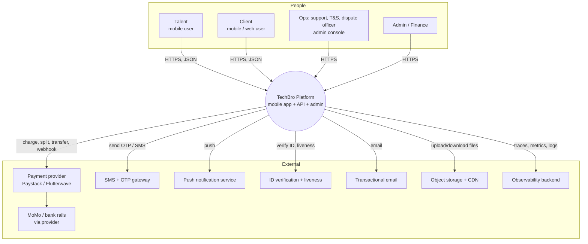
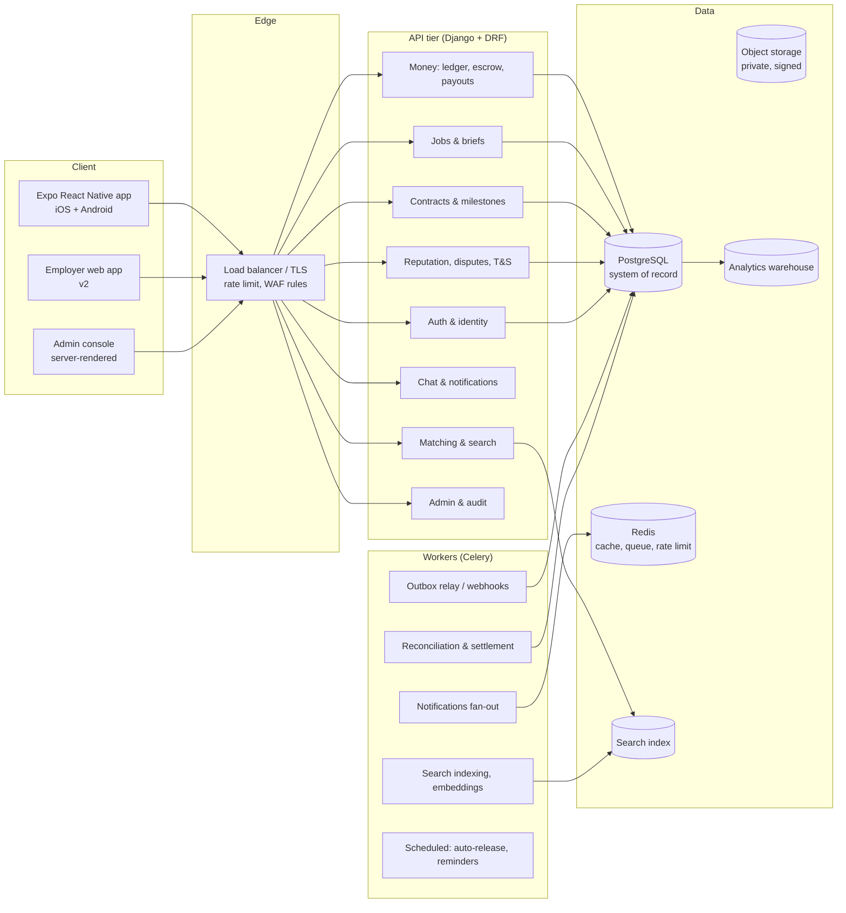

# 04 — System Architecture

> Stack decision (ADR-001): **React Native + Expo** mobile, **Django + DRF** API, **PostgreSQL**
> as the system of record, **Redis + Celery** for async work, deployed as containers behind a
> managed load balancer. Rationale in §4.9. Nothing here is sacred; everything here is reversible
> except §4.5 (money), which must be right the first time.

---

## 4.1 Context (C4 Level 1)



**Trust boundaries** (every one of these is a threat-model boundary, ART-048):

1. Device ↔ API (untrusted client, untrusted network).
2. API ↔ payment provider (money, webhook authenticity).
3. API ↔ object storage (signed URLs, virus scanning).
4. API ↔ admin console (privileged operations, separate auth).
5. Platform ↔ KYC provider (sensitive identity data, data minimisation).
6. CI/CD ↔ production (deployment credentials — the most attacked boundary in practice).

## 4.2 Container view (C4 Level 2)



**Why this shape:** a modular monolith (Django apps per bounded context) with clearly named
boundaries, one database, and an outbox table for events. At the expected scale (tens of thousands
of users) a monolith is not a compromise — microservices would add distributed-systems failure modes
to a team that has not yet found product-market fit. The boundaries are enforced in code and in
review so that extraction is possible later, not required now.

## 4.3 Request path (happy path: client accepts a milestone)

```mermaid
sequenceDiagram
  participant App as Client app
  participant API as API (Django)
  participant PG as PostgreSQL
  participant Prov as Payment provider
  participant W as Celery worker
  participant Talent as Talent app

  App->>API: POST /milestones/{id}/accept (Idempotency-Key)
  API->>PG: BEGIN; lock milestone FOR UPDATE
  API->>PG: INSERT ledger entry (release: escrow → talent wallet)
  API->>PG: INSERT outbox event MilestoneAccepted
  API->>PG: COMMIT
  API-->>App: 200 {state: accepted, payout: queued}
  W->>PG: read outbox (at-least-once)
  W->>Prov: initiate transfer (idempotent reference)
  Prov-->>W: webhook transfer.success
  W->>PG: UPDATE payout status; INSERT ledger entry (settled)
  W->>Talent: push + SMS fallback "GHS X released"
```

Three non-negotiables visible in that diagram:

- **The ledger write and the state change are one transaction.** Never "update status, then call
  the provider, then hope".
- **Provider call happens asynchronously, from an outbox.** The API never holds a database
  transaction open across a network call.
- **Every money call carries an idempotency key** derived from the business event, not from time.

## 4.4 Modules and bounded contexts (DDD)

| Context | Aggregate roots | Owns | Talks to |
| --- | --- | --- | --- |
| **Identity** | User, Verification, Session | phone, Ghana Card ref, liveness result, devices | everything (read-only) |
| **Talent Profile** | Profile, SkillSet, Portfolio | skills, levels, availability, rate card | Matching, Search |
| **Demand** | Client, JobPost, Brief | the structured brief, budget, deadlines | Matching, Contracts |
| **Matching** | MatchCandidate (derived) | ranking scores, explanations | reads Talent + Demand |
| **Contracts** | Engagement, Milestone, Deliverable | scope agreement, acceptance criteria | Money, Chat, Reputation |
| **Money** | Wallet, EscrowHold, LedgerEntry, Payout | all balances, all movements | Contracts, Disputes |
| **Reputation** | Review, Rating, TrustScore | two-sided ratings, score inputs | Matching, Trust & Safety |
| **Disputes** | Dispute, Evidence, Decision | claims, evidence, rulings, appeals | Money, Reputation, T&S |
| **Communications** | Conversation, Message, Notification | chat, push/SMS/email fan-out | everything (events) |
| **Moderation / T&S** | Report, Case, Action | abuse reports, takedowns, suspensions | Reputation, Identity |

**Aggregate rules that matter:**

- `EscrowHold` and `LedgerEntry` are **append-only**. Corrections are new entries, never updates.
- `Review` is **immutable after 14 days** (anti-retaliation window closes).
- `Verification` state transitions are **logged with actor, evidence hash, and timestamp**.

## 4.5 Money model (the part that must be right)

**The state machine** (one per milestone, and the ledger records every transition):

```
  UNFUNDED ──fund──▶ FUNDED ──work starts──▶ IN_PROGRESS
                                              │
                    ┌─────────────────────────┼──────────────────────────┐
                    ▼                         ▼                          ▼
              SUBMITTED                 CLIENT_ACCEPTS             DISPUTED
                    │                         │                          │
                    │                     RELEASED ──settle──▶ SETTLED   │
                    │                                                    ▼
                    └── auto-accept (T+7d) ──────────────────▶   RESOLVED_SPLIT
                                                                  ├─ release_to_talent
                                                                  ├─ refund_to_client
                                                                  └─ split (partial)
```

**Ledger design (double-entry, the only defensible design for a marketplace):**

| Account type | Normal side | Purpose |
| --- | --- | --- |
| `client_funds_held` (asset) | debit | money received and held before release |
| `escrow_liability` (liability) | credit | the platform's obligation to client or talent |
| `talent_wallet` (liability) | credit | money owed to a worker, not yet paid out |
| `platform_revenue` (income) | credit | the take rate |
| `provider_fees` (expense) | debit | PSP charges |
| `payouts_in_transit` (asset) | debit | initiated, not yet confirmed |
| `refunds_payable` (liability) | credit | approved, not yet refunded |

**Invariants — enforced in code and tested as properties (ART-137):**

1. `Σ debits = Σ credits` for every transaction batch.
2. `escrow_liability = Σ funded − Σ released − Σ refunded` at all times.
3. No ledger entry is ever updated or deleted; the table is append-only (DB permission, not just
   convention).
4. Every entry references exactly one `milestone_id` **or** one `payout_id`, never zero, never both.
5. Money is stored as integer minor units (pesewas) — never floats. ISO 4217 currency code on every row.
6. A payout cannot exceed the wallet balance at the moment of initiation (row-locked check).

**Licensing position (this is a legal question, not a technical one).** Under the Payment Systems
and Services Act, 2019 (Act 987 — S5), a body corporate may not operate a payment system or provide
a payment service without a Bank of Ghana licence. Holding client money in escrow *can* fall inside
that perimeter. The design therefore has three compliant postures, in order of preference:

| Posture | How it works | What we must not do | Owner / gate |
| --- | --- | --- | --- |
| **A. Provider-side split with delayed settlement** (launch posture) | Provider holds the talent share; platform triggers release on acceptance; platform's own fee settles normally | Must not describe this as "escrow"; must not hold funds in a platform bank account beyond provider settlement windows | D018, D100 |
| **B. Licensed escrow partner** | A licensed institution holds funds under a tripartite agreement | Must not commingle; must reconcile daily to the partner's statement | D018, D023 |
| **C. Own licence** | Platform obtains the appropriate BoG authorisation | Must not operate while an application is pending without written guidance | D018, D001 |

Paystack's own documentation states it does not provide true escrow, that release is one-directional
and that refunds on settled splits come from the main balance (S11). Therefore:

- We use **posture A until volumes justify B**, and we write in the T&Cs exactly what the mechanism is.
- **Credit risk is explicit:** if a client refund is owed after the talent share was settled, the
  platform funds it first and recovers afterwards. That recovery risk is bounded by a per-job cap
  and tracked in ART-086.
- The **ledger is built to outlive the posture**: switching from provider-held to partner-held escrow
  is a settlement change, not a data-model change. That is why the ledger is ours from day one.

## 4.6 Matching design (v0 → v3)

Matching is where product and ML meet, and where the temptation to over-engineer is strongest.

| Version | Method | When | Why not later |
| --- | --- | --- | --- |
| **v0** | SQL filters: skill ∩ level ∧ availability ∧ city ∧ rate range, ordered by last-active + rating | MVP | Zero ML risk; explainable in one sentence; builds the labelled data future models need |
| **v1** | Weighted score: skill overlap (taxonomy distance), rating (Bayesian-smoothed), completion rate, response time, price fit, recency, plus hard filters | v1 | Capture the obvious quality signals explicitly; weights are reviewable |
| **v2** | Learning-to-rank on real outcomes (hire, completion, rating ≥4, repeat) with **hard guardrails** | After ≥2,000 completed engagements | Need labels; need fairness slices |
| **v3** | Embedding-based semantic matching for fuzzy skills + price guidance | After taxonomy is stable | Embeds the taxonomy's errors if done first |

**Non-negotiable matching rules:**

1. **Hard constraints first, ranking second.** A ranking model must never surface someone who is
   unavailable, unverified, or outside budget.
2. **Every result explains itself** ("matched on Flutter + 4.8★ + 2 similar jobs + available this week").
3. **Fairness slices are measured** (gender, city, school tier as proxy, new-vs-established) — not for
   quotas, but because undisclosed bias destroys the supply side quietly (ART-090, D090).
4. **Cold start is a product problem, not a model problem.** New talent gets a "rising" slot with
   limited exposure, like a new seller in any marketplace.
5. **No engagement-maximising ranking.** Sorting by "what makes the user open the app" rather than
   "what gets the job done" is misaligned with the North Star and will be rejected in design review.

Details in `07-matching-reputation.md`.

## 4.7 Data architecture

| Store | What | Why | Retention |
| --- | --- | --- | --- |
| PostgreSQL | users, jobs, contracts, ledger, disputes, reviews | ACID, relational integrity, one source of truth | per ART-085 (7 years for financial records — S27) |
| Redis | session/rate-limit counters, Celery broker, cache | speed; **never** the only copy of anything | ephemeral |
| Object storage (private bucket) | IDs, portfolios, deliverables, dispute evidence | cheap, durable, signed-URL access | per data class; IDs deleted at KYC retention limit |
| Search index | talent and job documents | fast faceted search | rebuildable from PG at any time |
| Warehouse (analytics) | event stream + periodic snapshots | analytics without loading production | aggregates kept; PII minimised |
| Audit log (append-only) | every privileged action | accountability; incident forensics | 7 years |

**Data classes and handling** (full inventory in ART-029/036):

| Class | Examples | Sensitivity | Handling rule |
| --- | --- | --- | --- |
| Identity | name, phone, Ghana Card number, selfie | High | encrypted at rest; card number tokenised; never in logs; access audited |
| Financial | wallet balances, payouts, bank/MoMo numbers | High | encrypted; masked in UI; 4-eyes for manual adjustments |
| Work content | briefs, messages, files | Medium | private by default; retention 24 months after closure |
| Behavioural | events, device, search history | Medium | pseudonymised in analytics; no ad-tech sharing |
| Public profile | display name, skills, ratings | Public | user-controlled visibility |

**Data residency.** Act 843 permits cross-border transfer only on adequacy, appropriate safeguards,
or binding corporate rules; government data must stay in Ghana (S3). Our default is **host in the
EU (e.g. Frankfurt) or, if cost permits, an African region, with a documented transfer basis and a
DPC registration that lists the transfer**; identity documents are the last class to move and get
extra scrutiny. This is a decision for D054 + D018, recorded as ADR-006, not an infrastructure
convenience.

## 4.8 Cross-platform mobile architecture

| Concern | Decision | Notes |
| --- | --- | --- |
| Framework | **Expo (React Native)** with a development build | One codebase, OTA updates for JS, native modules when needed (S41) |
| Navigation | Expo Router (file-based) with typed routes | Deep links map to screens 1:1 |
| State | Server state in TanStack Query; UI state in Zustand | No global store for server data — cache invalidation is the bug factory |
| Forms | React Hook Form + Zod schemas shared with the API contract | One validation source |
| Storage | SecureStore/Keychain for tokens; MMKV for non-sensitive cache | Never AsyncStorage for tokens |
| Offline | Queue mutations that are safe (messages, drafts); never queue money actions blindly | Money actions require an online, confirmed state |
| Media | Compressed uploads, resumable, background retry | Assumes 3G (H-009) |
| Performance budget | Cold start <3s on a 2GB-RAM Android; JS bundle <8MB initial | Enforced in CI (ART-104) |
| Accessibility | Dynamic type, 44pt targets, screen-reader labels, contrast AA (S12) | Tested with TalkBack/VoiceOver (ART-102) |
| Updates | EAS Update for JS; store release for native changes | Rollback = republish previous update |

**Why not fully native:** the team is small, the UI is form-and-list heavy, and the differentiating
work is in trust and money flows, not in pixel-level platform APIs. Revisit if camera/liveness or
heavy media becomes core (that is a native-module decision, not a rewrite).

## 4.9 Technology decisions (summary ADR table)

| ADR | Decision | Alternatives rejected | Main reason | Reversibility |
| --- | --- | --- | --- | --- |
| ADR-001 | Django 5.2 LTS + DRF (S40) | FastAPI, Node/NestJS | Batteries-included security, ORM, admin, migrations; team familiarity; LTS support | Medium |
| ADR-002 | PostgreSQL 17 (S42) | MySQL, MongoDB | Transactions, constraints, JSONB, proven for financial data | Low (keep it) |
| ADR-003 | Expo React Native | Flutter, two native apps | One team, one language, OTA, faster iteration | Medium |
| ADR-004 | Modular monolith + outbox | Microservices | Distributed systems tax not yet payable | High (extract later) |
| ADR-005 | Celery + Redis (S43) | Cloud queues, Dramatiq | Mature, well-understood, in-stack | Medium |
| ADR-006 | Hosting region & transfer basis | Single-region Ghana-only hosting | Compliance vs cost vs latency; needs DPO sign-off (S3) | Medium |
| ADR-007 | Provider-side split *now*, own ledger always | Build full escrow first | Licensing risk (S5); ledger makes posture switchable | High |
| ADR-008 | Rule-based matching first | ML ranking from day one | No labels yet; trust requires explainability | High |
| ADR-009 | Admin console server-rendered | Separate SPA | Fewer moving parts for privileged UI; easier CSP | Medium |
| ADR-010 | Money as integer minor units + ISO currency | Decimal floats | Rounding bugs are unrecoverable in production | None |

## 4.10 Environments and promotion

| Environment | Data | Purpose | Access |
| --- | --- | --- | --- |
| `local` | synthetic fixtures | dev | developer laptop |
| `ci` | ephemeral containers | automated tests | pipeline only |
| `staging` | synthetic (ART-056) | UAT, demos, load tests | team + invited testers |
| `production` | real | users | on-call + break-glass (audited) |

Promotion is **artifact-based**: the exact image tested in staging is the image promoted. No
rebuilds. Config differs by environment; code does not (S32 — twelve-factor).

## 4.11 Failure modes and degradation

| Failure | User-visible behaviour | System behaviour | Why |
| --- | --- | --- | --- |
| Payment provider down | "Funding opens shortly"; job still postable | queue funding attempts; alert; no state change until confirmed | Never show money as moved when it is not |
| SMS gateway down | OTP via WhatsApp/voice fallback; visible banner | retry with backoff; escalate after 90s | Login is a hard dependency |
| Push down | In-app badge + SMS for money events only | queue; batch | Cost-aware fallback |
| Database primary failover | 30–60s errors; app shows retry | managed failover; read-only mode for non-money screens | Money writes fail closed |
| Redis down | Chat slower; queue paused | Celery retries; outbox drains when back | Outbox is the durability boundary, not Redis |
| Object storage down | Existing files cached; uploads queued | retry with backoff | Files are never the only path to money |
| KYC provider down | Manual review queue | queue, SLA 24h | Never auto-approve because a vendor is down |

**Fail-closed rule:** any component that decides *who gets money* or *who is allowed in* must fail
closed. Any component that only *shows* information may fail open with a clear message.

## 4.12 Capacity model (first principles)

Numbers below are a **planning model with explicit assumptions**, not a forecast:

| Input | Assumption | Source |
| --- | --- | --- |
| Registered users at month 12 | 20,000 (12k talent, 8k clients) | internal plan |
| Monthly active | 40% = 8,000 | assumption |
| Peak concurrent | 2% of MAU = 160 sessions | assumption |
| API requests / active session / day | 60 | assumption |
| Peak RPS | ~15 sustained, 60 burst | derived |
| DB size at 12 months | ~40 GB (messages and events dominate) | assumption |
| Media storage at 12 months | ~600 GB (portfolios, deliverables) | assumption |
| Notifications/month | ~400k (push 85%, SMS 10%, email 5%) | assumption |

Derived conclusions: a single 4 vCPU / 8 GB API instance with 2 workers handles this with headroom;
the first real bottleneck is **PostgreSQL writes on the ledger during payout bursts**, not reads;
the second is **SMS cost**, not compute. Both are addressed by batching and by the outbox, and both
are tracked in ART-086. Re-derive this model when MAU crosses 10k — do not scale on vibes.

## 4.13 Anti-patterns explicitly forbidden

1. **Balance as a mutable column without a ledger.** Balances are always derived (or cached with a
   reconciliation job that proves equality to the ledger).
2. **`float` for money.** Ever.
3. **Provider webhooks trusted without signature verification and idempotency.**
4. **Cross-context database joins in application code** that bypass a module's public interface.
5. **Business logic in serializers or views.** It goes in a service layer with tests.
6. **Secrets in environment committed to the repo** or in mobile binaries.
7. **Admin endpoints sharing the mobile auth path** (separate audience, separate session, MFA mandatory).
8. **"Temporary" scripts against production data** without a reviewed migration and a backup.
