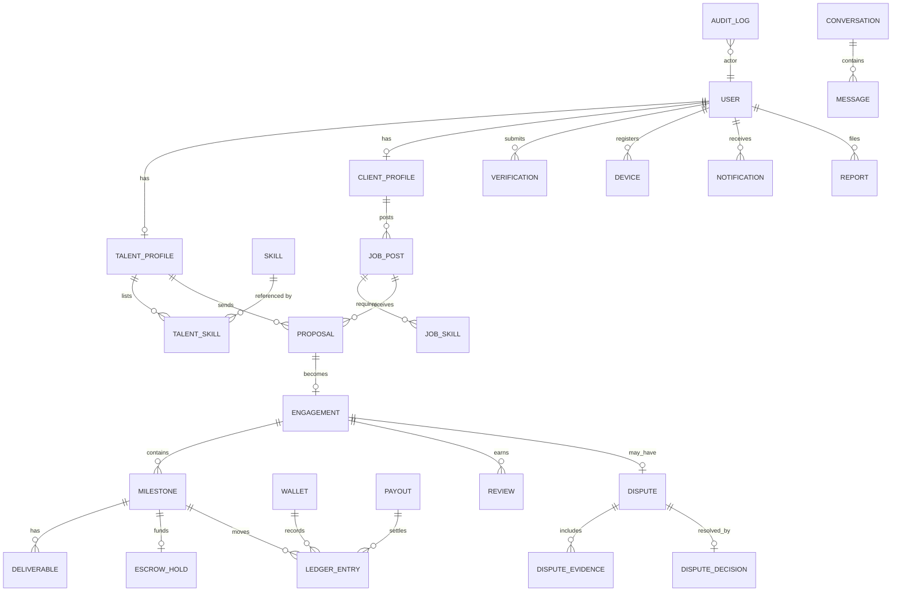

# 05 — Data Model & Dictionary

> DDL below is **illustrative PostgreSQL 17** (S42): it expresses the constraints that matter, not
> the final migration. In Django these become models; the constraints must survive the translation,
> because constraints are the cheapest place to be correct.

---

## 5.1 Conventions (binding)

| Rule | Detail |
| --- | --- |
| Primary keys | `UUID v7` (time-ordered, no enumeration leaks, index-friendly) |
| Money | `BIGINT` **minor units** (pesewas) + `currency CHAR(3)`; never `numeric`/`float` for balances |
| Timestamps | `TIMESTAMPTZ`, UTC; the UI localises. Never store local time. |
| Soft delete | Only for user-visible content; **ledger and audit are never deleted**, they are archived |
| Naming | `snake_case`; join tables `a_b`; views `v_`; materialised `mv_` |
| Enums | Postgres `ENUM` for stable sets, `TEXT + CHECK` for evolving sets |
| PII columns | Suffix `_enc` for ciphertext; declared in ART-036 with a PII flag |
| Audit | Every table has `created_at`, `updated_at`; privileged tables add `created_by`, `updated_by` |
| Multi-tenancy | Not multi-tenant at the DB level; isolation is by authorization, tested (ART-146) |

## 5.2 Entity map



## 5.3 Core tables (illustrative DDL)

```sql
-- ============ identity ============
CREATE TABLE app_user (
  id              UUID PRIMARY KEY,
  phone_e164      TEXT NOT NULL UNIQUE,            -- the login identifier
  phone_verified  BOOLEAN NOT NULL DEFAULT FALSE,
  email_enc       BYTEA,
  display_name    TEXT NOT NULL,
  legal_name_enc  BYTEA,                            -- for payouts / disputes
  country         CHAR(2) NOT NULL DEFAULT 'GH',
  locale          TEXT NOT NULL DEFAULT 'en-GH',
  status          TEXT NOT NULL DEFAULT 'active'
                  CHECK (status IN ('active','suspended','closed','deleted')),
  is_staff        BOOLEAN NOT NULL DEFAULT FALSE,
  created_at      TIMESTAMPTZ NOT NULL DEFAULT now(),
  updated_at      TIMESTAMPTZ NOT NULL DEFAULT now(),
  CONSTRAINT phone_shape CHECK (phone_e164 ~ '^\+[1-9][0-9]{7,14}$')
);

CREATE TABLE verification (
  id             UUID PRIMARY KEY,
  user_id        UUID NOT NULL REFERENCES app_user(id),
  kind           TEXT NOT NULL CHECK (kind IN ('ghana_card','selfie_liveness','address','business_reg')),
  status         TEXT NOT NULL DEFAULT 'pending'
                 CHECK (status IN ('pending','approved','rejected','expired')),
  provider       TEXT,
  provider_ref   TEXT,
  evidence_hash  TEXT NOT NULL,          -- sha256 of stored document; never the document itself here
  reviewed_by    UUID REFERENCES app_user(id),
  reviewed_at    TIMESTAMPTZ,
  expires_at     TIMESTAMPTZ,
  created_at     TIMESTAMPTZ NOT NULL DEFAULT now()
);
CREATE INDEX ON verification (user_id, kind, status);

-- ============ talent & demand ============
CREATE TABLE talent_profile (
  user_id        UUID PRIMARY KEY REFERENCES app_user(id),
  headline       TEXT NOT NULL,
  bio            TEXT,
  years_exp      SMALLINT CHECK (years_exp BETWEEN 0 AND 60),
  hourly_min_ghs BIGINT CHECK (hourly_min_ghs >= 0),   -- pesewas
  availability   TEXT NOT NULL DEFAULT 'open'
                 CHECK (availability IN ('open','limited','unavailable')),
  city           TEXT,
  languages      TEXT[] NOT NULL DEFAULT '{en}',
  is_verified    BOOLEAN NOT NULL DEFAULT FALSE,
  rating_bayes   NUMERIC(3,2),                          -- materialised, recomputed nightly
  completed_jobs INTEGER NOT NULL DEFAULT 0,
  updated_at     TIMESTAMPTZ NOT NULL DEFAULT now()
);
CREATE INDEX ON talent_profile (availability) WHERE is_verified;

CREATE TABLE skill (
  id        UUID PRIMARY KEY,
  slug      TEXT NOT NULL UNIQUE,          -- 'flutter', 'django', 'postgresql'
  label     TEXT NOT NULL,
  family    TEXT NOT NULL,                 -- 'mobile', 'backend', 'data', ...
  parent_id UUID REFERENCES skill(id),
  aliases   TEXT[] NOT NULL DEFAULT '{}'   -- 'flutter', 'dart ui', 'flutter dev'
);

CREATE TABLE talent_skill (
  user_id     UUID REFERENCES talent_profile(user_id),
  skill_id    UUID REFERENCES skill(id),
  level       SMALLINT NOT NULL CHECK (level BETWEEN 1 AND 5),  -- L1 aware .. L5 expert
  years       SMALLINT CHECK (years BETWEEN 0 AND 60),
  is_primary  BOOLEAN NOT NULL DEFAULT FALSE,
  assessed_at TIMESTAMPTZ,                                       -- null = self-declared
  PRIMARY KEY (user_id, skill_id)
);

CREATE TABLE client_profile (
  user_id      UUID PRIMARY KEY REFERENCES app_user(id),
  org_name     TEXT,
  org_type     TEXT CHECK (org_type IN ('startup','sme','ngo','agency','individual')),
  is_business_verified BOOLEAN NOT NULL DEFAULT FALSE,
  created_at   TIMESTAMPTZ NOT NULL DEFAULT now()
);

CREATE TABLE job_post (
  id             UUID PRIMARY KEY,
  client_id      UUID NOT NULL REFERENCES client_profile(user_id),
  title          TEXT NOT NULL CHECK (length(title) BETWEEN 8 AND 120),
  outcome        TEXT NOT NULL,       -- what must be true when done (not "responsibilities")
  deliverables   JSONB NOT NULL,      -- [{description, acceptance_criteria}]
  budget_min_ghs BIGINT NOT NULL CHECK (budget_min_ghs > 0),
  budget_max_ghs BIGINT NOT NULL,
  currency       CHAR(3) NOT NULL DEFAULT 'GHS',
  deadline       DATE,
  engagement_type TEXT NOT NULL CHECK (engagement_type IN ('fixed','milestone','retainer')),
  status         TEXT NOT NULL DEFAULT 'draft'
                 CHECK (status IN ('draft','open','paused','filled','cancelled','expired')),
  visibility     TEXT NOT NULL DEFAULT 'public' CHECK (visibility IN ('public','invite_only')),
  published_at   TIMESTAMPTZ,
  created_at     TIMESTAMPTZ NOT NULL DEFAULT now(),
  CONSTRAINT budget_order CHECK (budget_max_ghs >= budget_min_ghs)
);
CREATE INDEX ON job_post (status, published_at DESC);

-- ============ contracts ============
CREATE TABLE proposal (
  id            UUID PRIMARY KEY,
  job_id        UUID NOT NULL REFERENCES job_post(id),
  talent_id     UUID NOT NULL REFERENCES talent_profile(user_id),
  cover_note    TEXT NOT NULL,
  price_ghs     BIGINT NOT NULL CHECK (price_ghs > 0),
  eta_days      SMALLINT NOT NULL CHECK (eta_days > 0),
  status        TEXT NOT NULL DEFAULT 'sent'
                CHECK (status IN ('sent','shortlisted','accepted','rejected','withdrawn')),
  created_at    TIMESTAMPTZ NOT NULL DEFAULT now(),
  UNIQUE (job_id, talent_id)                 -- one active proposal per talent per job
);

CREATE TABLE engagement (
  id            UUID PRIMARY KEY,
  job_id        UUID NOT NULL REFERENCES job_post(id),
  proposal_id   UUID NOT NULL UNIQUE REFERENCES proposal(id),
  client_id     UUID NOT NULL REFERENCES client_profile(user_id),
  talent_id     UUID NOT NULL REFERENCES talent_profile(user_id),
  total_ghs     BIGINT NOT NULL CHECK (total_ghs > 0),
  platform_fee  BIGINT NOT NULL CHECK (platform_fee >= 0),
  currency      CHAR(3) NOT NULL DEFAULT 'GHS',
  scope_hash    TEXT NOT NULL,               -- hash of agreed scope document (both accepted)
  status        TEXT NOT NULL DEFAULT 'active'
                CHECK (status IN ('active','completed','cancelled','disputed')),
  started_at    TIMESTAMPTZ NOT NULL DEFAULT now(),
  completed_at  TIMESTAMPTZ,
  CONSTRAINT fee_le_total CHECK (platform_fee < total_ghs),
  CONSTRAINT no_self_hire CHECK (client_id <> talent_id)
);

CREATE TABLE milestone (
  id             UUID PRIMARY KEY,
  engagement_id  UUID NOT NULL REFERENCES engagement(id),
  seq            SMALLINT NOT NULL,
  title          TEXT NOT NULL,
  amount_ghs     BIGINT NOT NULL CHECK (amount_ghs > 0),
  acceptance     TEXT NOT NULL,              -- testable acceptance criteria
  due_date       DATE,
  status         TEXT NOT NULL DEFAULT 'unfunded'
                 CHECK (status IN ('unfunded','funded','in_progress','submitted',
                                   'accepted','released','disputed','refunded','cancelled')),
  submitted_at   TIMESTAMPTZ,
  auto_accept_at TIMESTAMPTZ,                -- T+7d after submission (configurable)
  accepted_at    TIMESTAMPTZ,
  UNIQUE (engagement_id, seq),
  CONSTRAINT sum_check_placeholder CHECK (amount_ghs > 0)
);
```

**Milestone sum invariant** — total of milestones must equal engagement total. Enforce with a
deferred constraint trigger plus a nightly reconciliation query, because application code is not a
guarantee:

```sql
CREATE OR REPLACE FUNCTION assert_milestone_sum() RETURNS trigger AS $$
DECLARE total BIGINT; expected BIGINT;
BEGIN
  SELECT COALESCE(SUM(amount_ghs),0) INTO total FROM milestone
   WHERE engagement_id = NEW.engagement_id AND status <> 'cancelled';
  SELECT total_ghs INTO expected FROM engagement WHERE id = NEW.engagement_id;
  IF total > expected THEN
    RAISE EXCEPTION 'milestone sum % exceeds engagement total %', total, expected;
  END IF;
  RETURN NEW;
END $$ LANGUAGE plpgsql;
```

## 5.4 Money tables (append-only)

```sql
CREATE TABLE wallet (
  id           UUID PRIMARY KEY,
  owner_type   TEXT NOT NULL CHECK (owner_type IN ('user','platform','escrow')),
  owner_id     UUID,                       -- null for platform/escrow
  currency     CHAR(3) NOT NULL,
  balance_cache BIGINT NOT NULL DEFAULT 0, -- derived; verified against ledger nightly
  created_at   TIMESTAMPTZ NOT NULL DEFAULT now()
);
CREATE UNIQUE INDEX ON wallet (owner_type, COALESCE(owner_id,'00000000-0000-0000-0000-000000000000'::uuid), currency);

CREATE TABLE ledger_txn (
  id            UUID PRIMARY KEY,
  kind          TEXT NOT NULL,            -- 'fund','release','refund','payout','fee','adjustment'
  reference_type TEXT NOT NULL,           -- 'milestone','payout','dispute'
  reference_id  UUID NOT NULL,
  idempotency_key TEXT NOT NULL UNIQUE,   -- derived from business event, not from time
  created_at    TIMESTAMPTZ NOT NULL DEFAULT now(),
  created_by    UUID REFERENCES app_user(id),
  memo          TEXT
);

CREATE TABLE ledger_entry (
  id            BIGSERIAL PRIMARY KEY,     -- insertion order matters
  txn_id        UUID NOT NULL REFERENCES ledger_txn(id),
  wallet_id     UUID NOT NULL REFERENCES wallet(id),
  direction     TEXT NOT NULL CHECK (direction IN ('debit','credit')),
  amount        BIGINT NOT NULL CHECK (amount > 0),
  currency      CHAR(3) NOT NULL,
  created_at    TIMESTAMPTZ NOT NULL DEFAULT now()
);
CREATE INDEX ON ledger_entry (wallet_id, id);
CREATE INDEX ON ledger_entry (txn_id);

-- append-only enforcement: no UPDATE, no DELETE, ever
CREATE OR REPLACE RULE ledger_entry_no_update AS ON UPDATE TO ledger_entry DO INSTEAD NOTHING;
CREATE OR REPLACE RULE ledger_entry_no_delete AS ON DELETE TO ledger_entry DO INSTEAD NOTHING;

CREATE TABLE escrow_hold (
  id            UUID PRIMARY KEY,
  milestone_id  UUID NOT NULL UNIQUE REFERENCES milestone(id),
  amount_ghs    BIGINT NOT NULL CHECK (amount_ghs > 0),
  currency      CHAR(3) NOT NULL DEFAULT 'GHS',
  status        TEXT NOT NULL DEFAULT 'held'
                CHECK (status IN ('held','partially_released','released','refunded','forfeited')),
  provider_ref  TEXT,                      -- subaccount/split reference, if posture A
  funded_at     TIMESTAMPTZ NOT NULL,
  released_at   TIMESTAMPTZ
);

CREATE TABLE payout (
  id            UUID PRIMARY KEY,
  user_id       UUID NOT NULL REFERENCES app_user(id),
  amount_ghs    BIGINT NOT NULL CHECK (amount_ghs > 0),
  currency      CHAR(3) NOT NULL DEFAULT 'GHS',
  rail          TEXT NOT NULL CHECK (rail IN ('momo_mtn','momo_telecel','momo_ati','bank')),
  destination_enc BYTEA NOT NULL,          -- masked number / account, encrypted
  destination_last4 TEXT NOT NULL,
  status        TEXT NOT NULL DEFAULT 'queued'
                CHECK (status IN ('queued','processing','paid','failed','reversed')),
  provider_ref  TEXT UNIQUE,
  idempotency_key TEXT NOT NULL UNIQUE,
  initiated_at  TIMESTAMPTZ NOT NULL DEFAULT now(),
  settled_at    TIMESTAMPTZ,
  failure_code  TEXT
);
```

**Reconciliation queries** (must return zero rows; run every 15 minutes; alert on any row):

```sql
-- 1. ledger must balance per transaction
SELECT txn_id, SUM(CASE WHEN direction='debit' THEN amount ELSE -amount END) AS delta
  FROM ledger_entry GROUP BY txn_id HAVING SUM(CASE WHEN direction='debit' THEN amount ELSE -amount END) <> 0;

-- 2. cached balances must equal the ledger
SELECT w.id, w.balance_cache,
       COALESCE(SUM(CASE WHEN le.direction='credit' THEN le.amount ELSE -le.amount END),0) AS derived
  FROM wallet w LEFT JOIN ledger_entry le ON le.wallet_id = w.id
 GROUP BY w.id, w.balance_cache
HAVING w.balance_cache <> COALESCE(SUM(CASE WHEN le.direction='credit' THEN le.amount ELSE -le.amount END),0);

-- 3. escrow liability must equal funded minus released minus refunded
SELECT COALESCE(SUM(eh.amount_ghs),0)
       - COALESCE((SELECT SUM(amount) FROM ledger_entry le
                    JOIN wallet w ON w.id = le.wallet_id
                   WHERE w.owner_type='escrow'),0) AS escrow_delta
  FROM escrow_hold eh WHERE eh.status = 'held';
```

## 5.5 Reputation, disputes, communications

```sql
CREATE TABLE review (
  id            UUID PRIMARY KEY,
  engagement_id UUID NOT NULL REFERENCES engagement(id),
  author_id     UUID NOT NULL REFERENCES app_user(id),
  subject_id    UUID NOT NULL REFERENCES app_user(id),
  rating        SMALLINT NOT NULL CHECK (rating BETWEEN 1 AND 5),
  comment       TEXT CHECK (length(comment) <= 1500),
  dimensions    JSONB,      -- {communication, quality, timeliness, professionalism}
  is_public     BOOLEAN NOT NULL DEFAULT TRUE,
  created_at    TIMESTAMPTZ NOT NULL DEFAULT now(),
  editable_until TIMESTAMPTZ NOT NULL,           -- created_at + 14 days, then immutable
  UNIQUE (engagement_id, author_id),
  CONSTRAINT no_self_review CHECK (author_id <> subject_id)
);

CREATE TABLE dispute (
  id            UUID PRIMARY KEY,
  engagement_id UUID NOT NULL REFERENCES engagement(id),
  milestone_id  UUID REFERENCES milestone(id),
  raised_by     UUID NOT NULL REFERENCES app_user(id),
  category      TEXT NOT NULL CHECK (category IN ('not_delivered','quality','scope','payment','conduct','fraud')),
  claim         TEXT NOT NULL,
  amount_ghs    BIGINT NOT NULL CHECK (amount_ghs >= 0),
  status        TEXT NOT NULL DEFAULT 'open'
                CHECK (status IN ('open','awaiting_evidence','under_review','decided','appealed','closed')),
  sla_due_at    TIMESTAMPTZ NOT NULL,        -- e.g. raised_at + 5 business days
  created_at    TIMESTAMPTZ NOT NULL DEFAULT now()
);
CREATE INDEX ON dispute (status, sla_due_at);

CREATE TABLE dispute_decision (
  id           UUID PRIMARY KEY,
  dispute_id   UUID NOT NULL UNIQUE REFERENCES dispute(id),
  decided_by   UUID NOT NULL REFERENCES app_user(id),
  outcome      TEXT NOT NULL CHECK (outcome IN ('release_full','refund_full','split','rework')),
  talent_pct   SMALLINT NOT NULL CHECK (talent_pct BETWEEN 0 AND 100),
  rationale    TEXT NOT NULL CHECK (length(rationale) >= 80),  -- reasons must be written
  decided_at   TIMESTAMPTZ NOT NULL DEFAULT now(),
  appeal_deadline TIMESTAMPTZ NOT NULL
);

CREATE TABLE audit_log (
  id          BIGSERIAL PRIMARY KEY,
  actor_id    UUID REFERENCES app_user(id),
  actor_role  TEXT,
  action      TEXT NOT NULL,             -- 'verification.approve', 'payout.manual_adjust'
  entity_type TEXT NOT NULL,
  entity_id   UUID,
  before      JSONB,
  after       JSONB,
  ip_hash     TEXT,
  user_agent  TEXT,
  created_at  TIMESTAMPTZ NOT NULL DEFAULT now()
);
CREATE INDEX ON audit_log (entity_type, entity_id, created_at DESC);
CREATE INDEX ON audit_log (actor_id, created_at DESC);
```

**Audit rules:** every admin mutation writes an `audit_log` row **in the same transaction** as the
change; the console has no path that can mutate without it. Manual money adjustments require two
distinct staff actors (4-eyes) recorded as two rows.

## 5.6 Key indexes and why

| Index | Query it serves | Notes |
| --- | --- | --- |
| `job_post (status, published_at DESC)` | job feed | partial index on `status='open'` |
| `proposal (job_id, status)` | client's proposal list | |
| `milestone (engagement_id, seq)` | contract view | |
| `ledger_entry (wallet_id, id)` | balance history, pagination | BRIN not suitable (high cardinality) |
| `dispute (status, sla_due_at)` | ops queue ordered by breach risk | |
| `talent_skill (skill_id, level DESC)` | matching pre-filter | |
| GIN on `talent_profile (languages)` and `skill.aliases` | search | |
| `notification (user_id, read_at)` partial where `read_at IS NULL` | badge count | |

## 5.7 Migration safety rules

1. **Expand → migrate → contract.** Never rename or drop a column in the same release that stops
   writing to it.
2. **Every migration is reversible or explicitly declared irreversible** with a backup step.
3. **No table-locking migration on a large table during business hours**; use `CONCURRENTLY` for
   indexes, and batch backfills.
4. **Test migrations on a production-size copy** before the real run (ART-104 evidence).
5. **Money tables:** migrations touching them require a second reviewer (D100 + D104).

## 5.8 Data dictionary extract (full version generated into ART-036)

| Table.column | Type | Null | PII | Meaning | Retention |
| --- | --- | --- | --- | --- | --- |
| `app_user.phone_e164` | text | no | **yes** | login identifier, E.164 | life of account + 30d |
| `app_user.legal_name_enc` | bytea | yes | **yes** | payout/dispute identity | 7y (financial — S27) |
| `verification.evidence_hash` | text | no | derived | integrity proof of ID doc | 7y |
| `verification.provider_ref` | text | yes | **yes** | KYC vendor reference | 7y |
| `talent_profile.rate` | bigint | yes | no | minimum rate, pesewas | life of profile |
| `talent_skill.level` | smallint | no | no | declared/assessed skill level 1–5 | life of profile |
| `job_post.outcome` | text | no | maybe | free text; may contain names | 24 months post-close |
| `message.body` | text | no | maybe | chat content | 24 months post-close |
| `payout.destination_enc` | bytea | no | **yes** | MoMo/bank destination | 7y |
| `review.comment` | text | yes | maybe | public review text | life of profile |
| `audit_log.ip_hash` | text | yes | pseudonymous | abuse investigation | 7y |

**Definition of done for this artefact (ART-035/036):** generated from the actual Django models,
diffed in CI against the live schema, and reviewed whenever a PII column is added. A data
dictionary that is written by hand drifts within one sprint.
