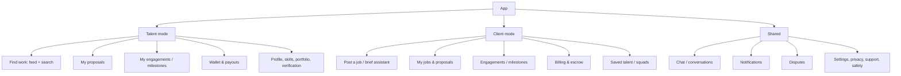

# 10 — UX, UI & Design System

> The design brief in one line: **a stranger with a 2GB Android phone on a 3G connection must be able
> to hire or get hired, understand exactly what is expected, and know where the money is, without
> calling support.** Everything below serves that sentence.

---

## 10.1 Design principles (with the failure each one prevents)

| # | Principle | Prevents |
| ---: | --- | --- |
| 1 | **Show the money state, always.** Every screen involving payment states where funds are (held / released / paid / frozen). | "Where is my money?" — the #1 support category on marketplaces |
| 2 | **Scope before match.** The brief is a form that produces a contract, not a free-text post. | Disputes caused by vague expectations (ART-042) |
| 3 | **Explain the match.** Every recommendation shows 2–3 reasons. | Distrust in the algorithm; invisible bias |
| 4 | **One primary action per screen.** | Decision paralysis on low-end devices |
| 5 | **Design for interruption.** Every form saves drafts; money actions never auto-submit. | Lost work on flaky networks/power |
| 6 | **Progressive disclosure.** Advanced fields are optional expansions, never gates. | Abandonment at signup |
| 7 | **Reversible by default.** Destructive actions require a second, explicit step with the consequence named. | Accidental payout changes, accidental accepts |
| 8 | **Write like a person.** No "utilise", no "leverage", no legal fog in the UI. | Misunderstanding of terms = disputes |
| 9 | **Accessible is not optional.** Contrast, targets, labels, dynamic type from day one. | Excluding users and rework later (S12) |
| 10 | **Trust is visible.** Verification badges, escrow status, dispute SLAs are UI elements, not policy PDFs. | The "is this a scam?" exit |

## 10.2 Personas driving design decisions

| Persona | Context | Design consequence |
| --- | --- | --- |
| **Kwame, 26, Flutter dev** (solo specialist) | Android mid-range, 4G but data-conscious, works from cafés | Fast proposal flow, saved templates, data-light images, offline drafts |
| **Ama, 34, startup founder** (client) | iPhone, busy, non-technical | Brief assistant, budget guidance, "what happens next" timeline |
| **Yaw, 21, junior dev** | Low-end Android, shared Wi-Fi, intermittent power | Small bundle, resumable uploads, no video requirement, text-first help |
| **Efua, 41, NGO programme officer** | Needs receipts and reports | Invoice PDFs, milestone reports, audit-friendly history |
| **Ops agent (internal)** | Desktop, 8h/day in queues | Keyboard-first, bulk actions, SLA timers visible, no modal hell |

## 10.3 Information architecture



**Dual-role users are the norm** (a senior dev both hires juniors and takes work). Mode switching is
a top-level, persistent control — not buried in settings — and the current mode is always visible to
prevent posting a job as a worker by mistake.

## 10.4 Screen inventory (42 screens for MVP)

| # | Screen | Purpose | Key states | Owner |
| ---: | --- | --- | --- | --- |
| 1 | Splash / session check | resume or route | cold start <3s | D098 |
| 2 | Onboarding carousel (3 slides, skippable) | value framing, mode choice | skippable | D105 |
| 3 | Phone entry | OTP start | invalid, rate-limited | D098 |
| 4 | OTP verify | authenticate | expired, wrong, resend timer | D098 |
| 5 | Role selection | talent / client / both | — | D105 |
| 6 | Profile basics | name, city, headline | validation | D098 |
| 7 | Skill picker | taxonomy search, level | empty search, aliases | D098 |
| 8 | Verification intro | why we ask, what is stored | consent required | D105 |
| 9 | Ghana Card capture | camera + guidance | blurry, glare, retry | D098 |
| 10 | Liveness / selfie | match | failure, retry | D098 |
| 11 | Verification pending | expectation setting (24h SLA) | approved/rejected | D098 |
| 12 | Portfolio upload | files, links | upload fail, resume | D098 |
| 13 | Talent home | matched jobs, nudges | empty, offline | D105 |
| 14 | Job feed | filters, saved searches | empty, loading | D098 |
| 15 | Job detail | brief, budget, client info | expired, filled | D098 |
| 16 | Match explanation sheet | why this job/skill fits | — | D105 |
| 17 | Proposal composer | price, ETA, note, milestones | draft saved | D098 |
| 18 | Proposal sent | next steps | — | D105 |
| 19 | My proposals | status list | empty | D098 |
| 20 | Brief assistant (chat) | structure a job | low confidence, fallback form | D098 |
| 21 | Job review & publish | edit AI draft | validation errors | D098 |
| 22 | My jobs | list, status | empty | D098 |
| 23 | Candidates list | ranked proposals | empty, sorting | D098 |
| 24 | Candidate detail | profile, proposal, reviews | — | D098 |
| 25 | Engagement created | terms summary, next step (fund escrow) | — | D105 |
| 26 | Fund escrow | provider redirect / MoMo prompt | pending, failed, succeeded | D098 |
| 27 | Engagement detail | milestones timeline, money state | disputed, completed | D098 |
| 28 | Submit milestone | files, notes, checklist | upload progress | D098 |
| 29 | Review submission | client accepts / requests changes | auto-accept timer | D098 |
| 30 | Wallet | balance, pending, history | zero balance | D098 |
| 31 | Payout setup | MoMo/bank destination, KYC gate | invalid number, change cooling period | D098 |
| 32 | Payout confirm | fee, ETA, destination last-4 | — | D105 |
| 33 | Transactions | ledger-backed list | empty | D098 |
| 34 | Chat list | conversations | empty | D098 |
| 35 | Conversation | messages, files, system events | offline send queue | D098 |
| 36 | Dispute open | category, claim, evidence | — | D105 |
| 37 | Dispute status | timeline, SLA, decision | appeal window | D098 |
| 38 | Review & rate | two-sided rating | editable window | D098 |
| 39 | Notifications | grouped, actionable | empty | D098 |
| 40 | Settings | account, privacy, consent, delete account | — | D098 |
| 41 | Help & support | RAG assistant + human escalation | no answer | D098 |
| 42 | Report / block | safety action | confirmation | D098 |

**Every screen has four designed states: empty, loading, error, and offline.** A screen without an
empty state is a screen that will look broken on day one of a new marketplace — when it is empty.

## 10.5 Core flows (with the friction budget)

### Flow A — Client posts a job (target: 6 minutes first time, 90 seconds repeat)

```
Home → "Post a job" → Brief assistant (5 prompts max) → Draft brief →
Review & edit → Budget guidance → Publish → See expected proposals time
```

Friction budget: **≤5 required fields before the draft exists**; everything else optional. The
assistant asks one question at a time (voice-friendly later), and a "just use the form" escape hatch
is always visible for users who hate chat interfaces.

### Flow B — Talent wins a job (target: 10 minutes from notification to proposal sent)

```
Push "3 new matches" → Job detail (money + scope visible) → "Why this matched" →
Proposal (price prefilled from rate card, ETA, milestones) → Send → Confirmation with next step
```

Friction budget: **one screen** between notification and proposal, with drafts and a saved template.

### Flow C — Money leaves escrow (the highest-stakes interaction)

```
Client opens engagement → Milestone submitted (checklist shown) →
"Accept & release GHS 1,500" → confirmation sheet restating:
   amount, who receives it, fee breakdown, "this cannot be undone" →
biometric/PIN → released → receipt + rating prompt
```

Rules: no swipe-to-accept, no pre-checked boxes, the fee is shown **before** the confirm, and the
word "release" is used consistently everywhere (never "approve" on one screen and "accept" on another).

### Flow D — Dispute (target: 3 minutes to file, no ambiguity about what happens next)

```
Milestone → "Something is wrong" → category (6 options, plain language) →
what happened (structured fields + free text) → evidence upload →
"SLA: first response within 24h, decision within 5 working days" → status timeline
```

## 10.6 Design system

### Colour (semantic, not decorative)

| Token | Use | Constraint |
| --- | --- | --- |
| `--color-primary` | primary action | ≥4.5:1 contrast on white |
| `--color-success` | released/paid states | never the only signal (icon + text too) |
| `--color-warning` | pending, action needed | |
| `--color-danger` | destructive, frozen funds | reserved: do not use for marketing |
| `--color-neutral-{0..900}` | text, surfaces, borders | |
| `--color-focus` | keyboard/switch focus | 3:1 against adjacent colours |

**Colour blindness rule:** every state also carries an icon and a label ("Held in escrow", not only
an amber dot). This is an accessibility requirement and a support-cost reduction in one.

### Type scale (mobile-first, dynamic-type ready)

| Token | Size / line height | Use |
| --- | --- | --- |
| `display` | 32/40 | empty-state headline only |
| `h1` | 24/32 | screen title |
| `h2` | 20/28 | section |
| `body` | 16/24 | default — never smaller for content |
| `body-sm` | 14/20 | metadata |
| `caption` | 12/16 | timestamps, legal links |
| `mono` | 14/20 | amounts, IDs, references |

Amounts are always `mono` and right-aligned in tables — money deserves a font that aligns.

### Spacing, radius, elevation

4-pt base scale (`4, 8, 12, 16, 24, 32, 48`); radius `8` for cards, `999` for pills; elevation via
2 levels only (surface, overlay). Flat design on low-end devices performs better and looks calmer.

### Component inventory (32 for MVP)

Buttons (primary/secondary/ghost/destructive), text field, phone field, OTP input, amount input
(with currency prefix and thousand separators), money-state chip, skill chip, level selector, avatar
+ verification badge, card, list row, section header, tab bar, segmented control, stepper (milestones),
file uploader, image picker, timeline (engagement), status banner, progress bar, rating stars,
review card, empty state, error state, offline banner, toast, bottom sheet, modal confirm, action
sheet, skeleton loader, pull-to-refresh, search field with filters.

**Each component ships with:** states (default/pressed/disabled/loading/error), accessibility labels,
RTL-safe layout, and a snapshot test.

## 10.7 Accessibility (WCAG 2.2 AA — S12)

| Requirement | Implementation | Verification |
| --- | --- | --- |
| Contrast | semantic tokens checked at build | automated token test |
| Touch targets | ≥44×44 pt | design review + automated check |
| Labels | every input has a programmatic label; icons have labels | lint (eslint-plugin-react-native-a11y) |
| Dynamic type | layouts reflow to 200% text | manual test on device |
| Screen reader | TalkBack/VoiceOver flows for the 6 critical journeys | ART-102 evidence |
| Focus order | logical on external keyboards/switch access | manual |
| Motion | respects "reduce motion" | code check |
| Error identification | text + icon, never colour alone; announced to screen readers | ART-102 |
| Timeouts | OTP and session timeouts warn and allow extension | design review |

## 10.8 Content design rules

1. **Reading level:** grade 8 or below for user-facing copy; tested with a readability check on
   key flows. Many users read English as a second or third language.
2. **Money copy:** always "GHS 1,500.00" (never "1500" alone); fees itemised before confirmation.
3. **Error copy:** what happened → what to do → how to get help. No error codes in the UI (they go in
   the details link).
4. **Local idiom:** en-GH English; avoid Americanisms; never machine-translate without native review
   (ART-294). Twi/Pidgin support is a v2 decision with evidence, not a checkbox.
5. **Legal copy:** the terms summary is 300 words in plain language; the full terms are linked and
   versioned, and acceptance is recorded.

## 10.9 Prototype & usability testing (ART-047)

| Round | Participants | Tasks | Success threshold |
| --- | ---: | --- | --- |
| R1 (wireframes) | 5 talent + 5 clients | find work / post a job / explain escrow | ≥70% task success, no severity-1 confusion |
| R2 (interactive) | 8 | proposal, fund, accept, dispute | ≥80% success; ≤1 critical error |
| R3 (beta build) | 20 (real) | end-to-end paid jobs | ≥60% completion without support |

Method: moderated, think-aloud, 30-minute sessions, recorded with consent, findings logged with
severity (S1 blocks the flow, S4 cosmetic). **Five users per round is enough to find most problems
and cheap enough to do often** (S13). Testing with only founders' friends is a known bias — recruit
at least half from outside the founding network.

## 10.10 Design QA checklist (per feature)

- [ ] All four states designed (empty/loading/error/offline)
- [ ] Money state visible wherever money is involved
- [ ] One primary action; destructive actions require confirmation naming the consequence
- [ ] Copy reviewed for plain language and consistency with the glossary (ART-020)
- [ ] Contrast and targets pass automated checks
- [ ] Screen-reader labels present; flow announced sensibly
- [ ] Works at 200% text on a small screen
- [ ] No layout shift while images load; skeletons match final layout
- [ ] Analytics events defined (ART-030) for the key step
- [ ] Error paths show a next step and a support route
