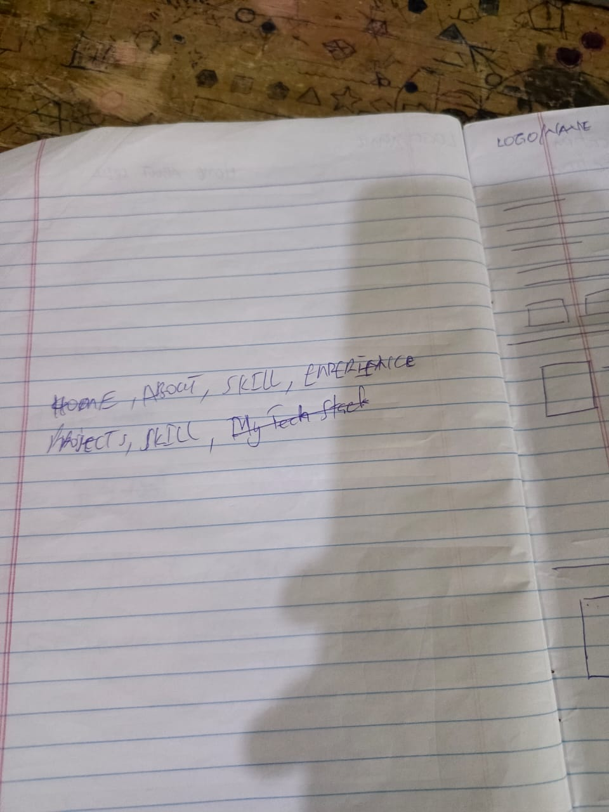
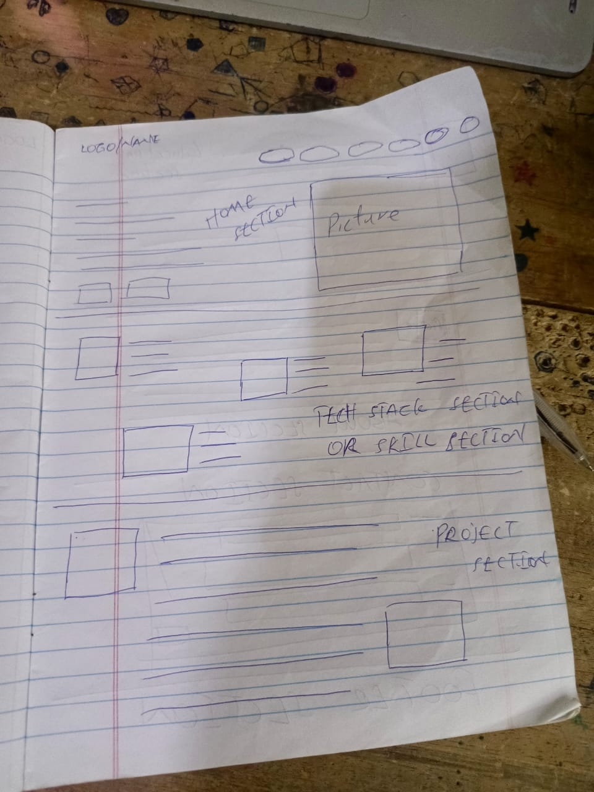
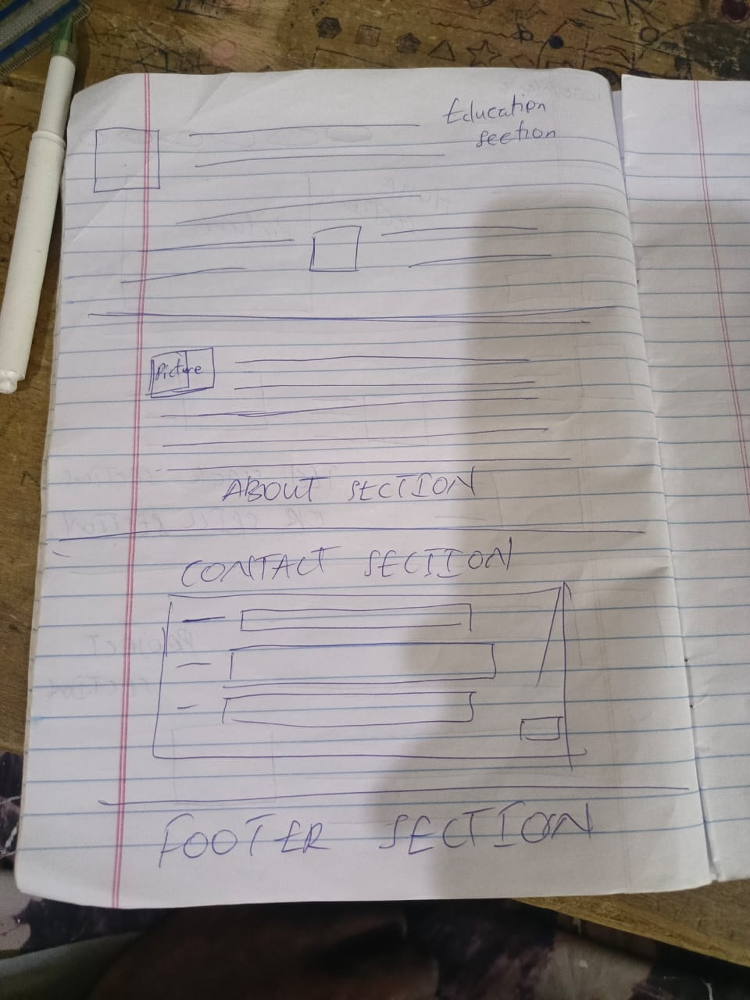

# Caleb Bentum — Pages and Sections

This document describes every page and scrollable section of the portfolio, the sketches they were built from, and what is still open. The site is a single scrolling page with no backend, no database and no contact form. All content is hardcoded in `src/data/`.

## Your sketches

| Sketch | What it shows | File |
|---|---|---|
| Navigation list | The menu items: Home, About, Skills, Experience, Projects, Skills, My tech stack |  |
| Home, skills and projects | Logo, home section with picture, tech stack or skill section, project section |  |
| About, education, contact and footer | Education section, picture with about section, contact form layout, footer |  |

The sketches are stored in `docs/sketches/` at the repository root.

## Site map

| # | Section | Anchor | Theme | Sketch it follows |
|---|---|---|---|---|
| — | Header | — | Dark, sticky | Navigation list |
| 01 | Home / hero | `#home` | Dark | Home section |
| 02 | About | `#about` | Light | About section |
| 03 | Skills | `#skills` | Dark | Tech stack / skill section |
| 04 | Projects | `#projects` | Dark | Project section |
| 05 | Approach | `#approach` | Light | Not sketched; added from your brief |
| 06 | Experience | `#experience` | Light | Education section |
| 07 | Contact | `#contact` | Dark | Contact section |
| — | Footer | — | Dark | Footer section |
| — | Back to top | — | Floating | Not sketched; appears after scrolling |

Navigation has six items. Your sketch lists "My tech stack" and "Experience" separately from "Skills" and "Projects". This build uses **Skills** for the tech stack and **Experience** for education and experience, so the list stays at six items.

## Header

- **Purpose:** move between sections, and always show who the page belongs to.
- **Content:** logo "CB." (links to the top), menu links, and a menu button on small screens.
- **Behaviour:**
  - Sticky at the top. It becomes more solid once the page has scrolled.
  - The current section is marked with `aria-current` and lime underline.
  - On screens narrower than 900px the menu opens and closes with the button. Escape closes it, and choosing a link also closes it.
- **Accessibility:** the menu button has `aria-expanded` and `aria-controls`. A skip link appears first in the tab order.

## 01 · Home / hero

- **Purpose:** identify you in the first few seconds.
- **Content:**
  - Eyebrow: "IT Student & Backend Developer"
  - Headline: "Hi, I'm Caleb Bentum."
  - Lead: a short line naming Python, PHP, MySQL and C++
  - Buttons: "View my work" (to Projects) and "Contact me" (to Contact)
  - A row of your four languages
  - A "Scroll" cue
- **Visual:** a dark background with a faint technical grid. A Three.js wireframe icosahedron and point field sit on the right. The scene reacts gently to the pointer and pauses when off-screen.
- **Motion:** Anime.js slides each headline word up from a mask once, on load.
- **Fallbacks:** the text and buttons do not depend on the 3D scene. If WebGL is unavailable, the scene is simply not drawn. Under reduced motion, the scene draws one still frame.

## 02 · About

- **Purpose:** introduce you and your study without overstating experience.
- **Content:**
  - Two short paragraphs about your study, the Rent & Lease project and StitchLedger
  - Your university and programme
  - A code-style card summarising your name, study, languages and current project
- **Visual:** a light, editorial layout with a code block on the right.
- **Motion:** the text and the code card fade up once as they scroll into view.

## 03 · Skills

- **Purpose:** show what you know, and where you have used it.
- **Content:**
  - Six skill cards: C++, Python, PHP, MySQL, HTML/CSS/JavaScript, Django
  - Each card shows a kind (Language, Database, Web, Framework), a one-line description and "Used in:" with a link to the project, or "No project yet."
  - A "Built with" row: React, TypeScript, Anime.js, Three.js, labelled as the tools used to build this site, not as past work
- **Rule:** a skill appears in the Used-in line only when it was used in that project. Skill bars and percentages are not used.

## 04 · Projects

- **Purpose:** present your work as evidence.
- **Content:** two project cards, each with:
  - A status badge: Implemented or In progress
  - Period and role
  - A summary, and the technologies
  - A "Show details" disclosure with the problem, your contribution, the features and any links
- **Projects:**
  1. **Rent & Lease Management System**, status Implemented. Group project, early 2026. You developed the backend. Technologies: Python, Django, HTML, CSS, JavaScript. Link to the repository.
  2. **StitchLedger**, status In progress. A personal project for fashion designers. Technology is marked "to be confirmed" and the features are labelled "Planned features".
- **Behaviour:** the disclosure uses `aria-expanded` and `aria-controls`. The repository link opens in a new tab and says so.
- **Placeholder art:** until you add a screenshot, each card shows its label ("R&L", "SL") in place of an image. To add a screenshot, put the file in `public/images/` and set `image` and `imageAlt` in `src/data/projects.ts`.

## 05 · Approach

- **Purpose:** show how you think about a project.
- **Content:** six steps: Understand, Plan, Design, Build, Test, Improve.
- **Honesty note:** the section says this is a general process, not a claim that every project followed each step.

## 06 · Experience

- **Purpose:** show your study and project experience in order.
- **Content:** three entries:
  1. Current — Information Technology, Regional Maritime University
  2. Early 2026 — Backend developer, group project, Rent & Lease Management System (authentication, verification and WebSocket chat)
  3. In progress — Developer, StitchLedger
- **Rule:** no years, grades, employers or certificates are invented. Add them only when you give them to me.

## 07 · Contact

- **Purpose:** make it easy to reach you.
- **Content:**
  - Your email as a `mailto:` link, with an "Email me" button
  - A "Copy email address" button, with a status message that is announced to screen readers
  - A link to your GitHub profile, which opens in a new tab
- **Why there is no form:** a static site cannot send form messages on its own. Adding a form would need an external service, which is not part of this build.

## Footer

- Copyright line with the current year (set in the browser), plus Email, GitHub and Back to top links.

## Back to top

- A round lime button that appears after you scroll about 800px. It is hidden and not focusable before that.

## Accessibility and motion (applies to every section)

- One `h1` (the hero), then one `h2` per section. Each section is labelled by its heading.
- Visible focus rings. Touch targets are at least 44px.
- Text contrast meets WCAG AA. The lowest text contrast in the palette is about 6.6:1.
- Under `prefers-reduced-motion`, all Anime.js motion and CSS transitions are removed. Content is visible immediately.
- Without JavaScript, the page content stays visible. Only the reveal animations depend on JavaScript.

## Responsive behaviour

| Width | Layout |
|---|---|
| 320–639px | One column. Menu button. Full-width buttons. |
| 640–859px | Skills in two columns. Approach in two columns. |
| 860–899px | Two-column About and Projects. Approach in three columns. |
| 900px and up | Full navigation bar. Hero split into text and 3D scene. |
| 1200px and up | Skills in three columns. |

## Open items (need your answer before publishing)

1. **Study year and dates:** question 4 was cut off in your reply. Tell me whether to show your current year of study, and whether you want a LinkedIn link.
2. **Screenshots:** add real screenshots for both projects when you have them.
3. **Rent & Lease status:** the repository's frontend spec says "production ready". This site says "Implemented", which is what you described. Tell me if you want a different label.
4. **Rent & Lease database:** the Django settings use SQLite, so MySQL is not listed as a tool for this project. Confirm this is right.
5. **Final domain:** the canonical URL in `index.html` is a placeholder (`https://example.com/`). Replace it with your domain.

## Answered

- Rent & Lease repository is public: `github.com/hotmoon123/hotmoon123`.
- Rent & Lease backend work: authentication, account verification and the WebSocket connection for chat.
- StitchLedger stack: React Native, Python (Django), FastAPI and OpenRouter.
