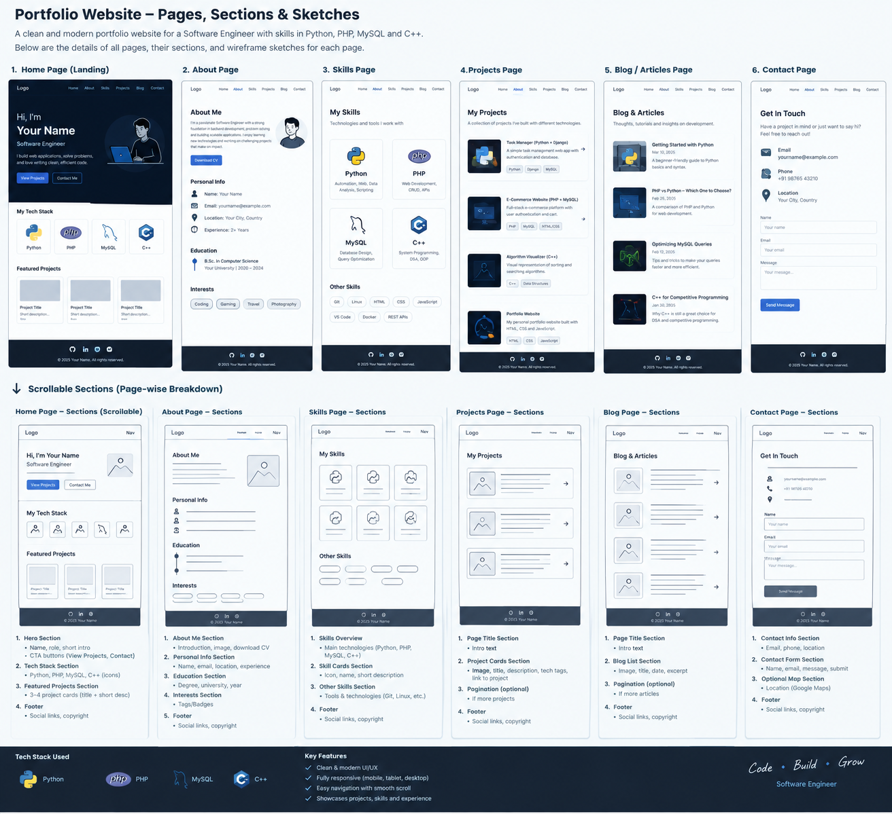

> **Update:** the site is now a React + TypeScript app (see `README.md`). The page and section list below still describes the content plan. The static HTML pages it once described were replaced by React routes with the same names: `/`, `/about`, `/skills`, `/projects`, `/projects/:slug`, `/experience`, `/education`, `/resume`, `/case-studies`, `/articles`, `/services`, `/contact`, and a 404 page.

# Portfolio: pages, scrollable sections, and sketches

A portfolio for a software engineer who works with **Python, PHP, MySQL, and C++**.



*Sketch board (`docs/sketches/page-sketches.png`). It shows the layouts of the Home, About, Skills, Projects, Blog, and Contact pages. It is a starting point, not a finished design. The site also has Experience, Case Study, Privacy, and 404 pages, described below.*

## How to read this document

- **Page**: a separate URL, reached from the navigation.
- **Scrollable section**: a block stacked vertically inside a page. Visitors scroll through the sections in order.
- **Status**: `Built` means the page exists in the repository now. `Planned` means it is described here for later, when there is real content for it.

## Site map

```
Portfolio
├── Home                      index.html                 Built
├── Projects                  projects/index.html        Built
│   ├── Project 1 (case study) projects/project-one.html  Built (template)
│   ├── Project 2 (case study) projects/project-two.html  Built (template)
│   └── Project 3 (case study) projects/project-three.html Built (template)
├── About                     about.html                 Built
├── Skills                    skills.html                Built
├── Experience & Education    experience.html            Built
├── Contact                   contact.html               Built
├── Privacy                   privacy.html               Built
├── 404 Not Found             404.html                   Built
├── Resume / CV (PDF)         [resume.pdf]              Planned: add the PDF file
├── Blog / Articles           /blog                      Planned: needs 2+ finished articles
├── Case Studies (index)      /case-studies              Planned: needs 3+ finished case studies
├── Services                  /services                  Planned: only if you take paid work
├── Testimonials              /testimonials              Planned: only with written permission
├── Research & Publications   /research                  Planned: only if you have research output
├── FAQ                       /faq                       Planned: when enquiries repeat
├── Terms of Use              /terms                     Planned: only if you sell or accept submissions
└── Admin dashboard           /admin                     Not planned: a static site does not need one
```

Navigation (every page): **Projects · About · Skills · Experience · Contact**. The logo returns to Home.

## Global elements

### Header and navigation
- Logo or name, linked to Home.
- Links to the five main pages. The current page has `aria-current="page"` and a visible underline.
- On a phone, the links wrap below the logo. If the list grows beyond about six items, collapse it into a menu button.
- Do not cover headings with a sticky header. Anchors use `scroll-margin-top` for this reason.

### Footer
- Name, one-line description, copyright year (filled in by `script.js`).
- Privacy link and "Back to top" link.
- Add GitHub, LinkedIn, and email links once you have them.

### Reusable components
- **Project card**: title, one-line summary, technology tags, status, link to the case study.
- **Skill card**: language name, three things you can do, and an evidence line that links to a project.
- **Status table**: Planned, Implemented, Tested, Deployed (used on case studies).
- **Call-to-action block**: one heading, one sentence, one or two links.

---

## 1. Home (`index.html`)

Purpose: in a few seconds, a visitor should know who you are, what you build, which four languages you use, and where to look next.

| # | Scrollable section | Content | Notes |
|---|---|---|---|
| 1 | **Hero** | Name, title ("Software Engineer"), one-line value statement, buttons *View projects*, *Contact me*, *Download CV* | Sketch: name, title, intro, two buttons, illustration. Do not claim experience you cannot show. |
| 2 | **My technology stack** | Four cards: Python, PHP, MySQL, C++. Each has one line on what it is used for and links to its skill entry. | Matches the sketch's "Tech stack" row. |
| 3 | **Featured projects** | Three project cards (screenshot, problem, technologies, link to details) | Choose by relevance. Three is enough. |
| 4 | **What I do** | Three capability blocks: backend and database apps, scripting and automation, algorithms | Each block links to a project. Remove the section if you do not offer paid work. |
| 5 | **How I build software** | Five steps: understand the requirement, design, implement in small steps, test and check security, review | Shows your process, not only your tools. |
| 6 | **About (preview)** | Two or three sentences plus a link to the full About page | Keep it short. |
| 7 | **Call to action** | Invitation to discuss a project, role, or collaboration; link to Contact | One primary action. |
| 8 | **Footer** | See global elements | |

**Acceptance check:** a visitor can state your role, two of your languages, and one project within 10 seconds of arriving.

---

## 2. Projects (`projects/index.html`)

Purpose: browse your work and open the case study you want.

Sections, in order:
1. **Page introduction**: what kinds of software you build. One heading, one sentence.
2. **Project list**: a grid of cards. Put your strongest project first (it can span the full width on desktop).
3. **Note and contact link**: "more projects will be added when they have a case study".
4. **Footer**.

Search and filters are not built. The guide's advice applies: three projects do not need filters. Add them when the list passes about eight projects. The planned filter options are Python, PHP, MySQL, C++, and status.

Empty state (for later, when filters exist): "No project matches this filter" with a *Reset filters* button.

---

## 3. Project case study (`projects/project-*.html`)

Route pattern: `/projects/project-name`. Each substantial project gets its own page, because this is where your engineering ability is shown.

Sections, in order (matches the guide's list):

| # | Section | What to write |
|---|---|---|
| — | **Header** | Project title, one-sentence description, buttons *Live demo* and *Source code* (only if they exist) |
| — | **Status** | Table: Planned / Implemented / Tested / Deployed, each with evidence. Current status label: Planned, In progress, Implemented, Tested, or Deployed. |
| 01 | Project overview | What it does, type, duration, your role, collaborators |
| 02 | Problem and users | The problem, for whom, and why it matters |
| 03 | Requirements | Functional (what users can do) and non-functional (security, reliability) |
| 04 | Features | The main user-visible capabilities |
| 05 | Technology stack | Only what was used, for example PHP, MySQL, Python, C++ |
| 06 | Architecture | Components and how they communicate, with a diagram if it helps |
| 07 | Database design | Tables, keys, relationships, one important design decision |
| 08 | Implementation | Your contribution, one or two short code excerpts, real screenshots |
| 09 | Security and testing | Validation, prepared statements, access control, test cases, known defects |
| 10 | Results and limitations | Demonstrated outcomes, with limits. No invented performance figures. |
| 11 | Lessons and future work | What you learned and the next specific improvement |
| — | **Previous / next project** and contact link | |

**Engineering-specific prompts for each stack:**
- **PHP**: show one route or handler, the validation step, and the prepared statement.
- **MySQL**: show the schema (or ER diagram) and one non-trivial query with joins, and say why the indexes exist.
- **Python**: show the entry point, one function with tests, and the input and output format.
- **C++**: show the core data structure, its complexity, and the test that checks it.

**Example for your RMU examination-system project** (fill in only what is true): the requirements, the database design, the lecturer-controlled AI-assisted marking flow, the test evidence, and an honest status. If the AI marking is still a prototype, say so, and do not present its accuracy as verified.

---

## 4. About (`about.html`)

Purpose: explain who you are beyond your languages.

Sections, in order:
1. **Introduction**: your background and current direction. One paragraph in your own voice.
2. **My story**: how you became interested in software, with two or three specific turning points.
3. **How I work**: engineering principles (for example correctness, security, maintainability), each with an example from a project.
4. **Experience and education**: a short timeline with a link to the full Experience page and a CV download.
5. **Call to action**: links to Projects, Skills, and Contact.

Recruiters need a clear summary, not a full autobiography. Keep it to about 400 words.

---

## 5. Skills (`skills.html`)

Purpose: show what you can do with each language, and link every claim to evidence.

Sections, in order:
1. **Page introduction**: every skill links to a project. Skills without evidence are not listed as strengths.
2. **Core languages**: one card each for **Python**, **PHP**, and **C++**. Each card has three bullet points on what you can do and an evidence line linking to a project. Edit the bullets to match what you have actually built.
3. **Database**: **MySQL** card covering modelling, querying, and transactions, with evidence.
4. **Software practice and tools**: only tools used on a real project (Git, GitHub, Linux, testing tool, editor, deployment platform).
5. **Currently learning**: separate from the list above, so it is not mistaken for experience.
6. **Call to action**: browse projects.

**What not to do:** no percentage skill bars (for example "Python 95%"). The guide notes these have no defensible basis. Evidence is more convincing.

---

## 6. Experience and education (`experience.html`)

Purpose: give verifiable background. This page replaces a separate Education and Certifications page for now.

Sections, in order:
1. **Introduction** with two buttons: *Download CV (PDF)* and *Contact me*.
2. **Work and practical experience**: a timeline. Each entry has context, your part, and the outcome. Academic and personal projects are shown here, labelled as such, and are not presented as paid employment.
3. **Education**: qualification, institution, dates or expected graduation, relevant coursework.
4. **Certifications and training**: completed items only. Anything still in progress is labelled as such.
5. **Call to action**: download CV, projects, contact.

If an entry cannot be described with a real context, action, and outcome, remove it.

---

## 7. Contact (`contact.html`)

Purpose: turn interest into a conversation.

Sections, in order:
1. **Introduction**: what to include in a message (what you are building, for whom, timeline).
2. **Ways to reach me**: email, LinkedIn, GitHub, the types of opportunity you welcome, and your expected reply time.
3. **Before you write**: a privacy note. The page has no form, so your email client sends the message directly.
4. **Footer**.

A contact form is **not built**, on purpose. The guide's form requirements (server validation, spam protection, rate limits, prepared statements) are real work. If you add one with PHP and MySQL later, use prepared statements for every query, escape all output, rate-limit submissions, and update the privacy notice.

---

## 8. Privacy (`privacy.html`)

Sections: what the site collects, email handling, your choices, third parties. The text must match what the site does. Update it when you add a form, analytics, or an embedded service.

## 9. Not Found (`404.html`)

Friendly message with links to Home, Projects, and Contact. Do not show server paths, stack traces, or internal route names.

---

## Planned pages and sections (not built)

Add these only when there is real content:

| Page | Build it when | Key sections |
|---|---|---|
| Resume / CV | You have a current PDF | Downloadable PDF, readable web version, summary, skills, experience, projects, education |
| Blog / Articles | You have two or more articles you can defend | Listing with search and pagination; article page with table of contents, code samples, references, related links |
| Case Studies (index) | You have three or more full case studies | Index of case studies, each showing problem, alternatives, decision, testing, outcome, lessons |
| Services | You take paid work | Service cards, process (requirements → proposal → development → testing → handover), FAQ, quote request |
| Testimonials | You have written permission | Quote, name, role, context, optional link to project |
| Research | You have publishable research | Questions, documents, methods, status, download links only where permitted |
| FAQ | Enquiries repeat | Short factual answers to recurring questions |
| Terms | You sell services, accept submissions, or host downloads | Acceptable use, licensing, disclaimers, contact |
| Admin dashboard | Content changes too often to edit by hand | Login with server-side checks, project and article management, enquiry list; see the security note below |

**Admin security:** if you build an admin area with PHP and MySQL, every admin endpoint must check authentication and authorisation on the server. Hiding a link in the interface is not protection.

---

## Scrolling behaviour

- Each page scrolls normally. Navigation links go to other pages, not to hidden panels.
- In-page anchors (for example `skills.html#python`) are used on long pages. Headings are offset so the header does not cover them.
- Smooth scrolling is on, and turned off for users who prefer reduced motion.
- Keep sections readable on a phone, with tap targets at least 44 px high.

## Error and status states

| State | Where | Message |
|---|---|---|
| 404 Not Found | Any unknown URL | Explains the page is missing; links to Home, Projects, Contact |
| Form success | Contact form, if built | Confirms the message was received |
| Form failure | Contact form, if built | Explains what to fix; keeps the entered text |
| Loading | Any dynamic content | Visible loading indicator |
| Empty results | Filters, if built | "No project matches" with a reset button |

Never show passwords, database credentials, stack traces, or other server details publicly.

## Technology per layer

| Layer | Tool | Role in this portfolio |
|---|---|---|
| Structure | HTML | Semantic pages and sections |
| Presentation | CSS | Layout, colours, responsive design |
| Interaction | JavaScript | Small progressive enhancements (year, reveal on scroll) |
| Server (optional) | PHP | Contact form or admin area, if added |
| Data (optional) | MySQL | Stored content or messages, if added |
| Demonstrated in projects | Python, C++ | Scripts and algorithm projects linked from Skills |

The site is static today. It needs no PHP or MySQL until you add a feature that stores data.

## Visual direction

- Light background, dark navy text, one blue accent (the sketch's palette). The current build uses a warm paper background with an ember accent, which you can change in the `:root` colour tokens in `styles.css`.
- Keep animations subtle and the pages fast.

## Build checklist (from the guide)

- [x] Phase 1: responsive header and footer, Home, About
- [x] Phase 2: Skills (Python, PHP, MySQL, C++), Projects listing, case-study template
- [x] Phase 3: Experience and education page, Contact page
- [x] Phase 4: Privacy page, 404 page, sitemap, robots
- [ ] Add a real screenshot and GitHub link to each project
- [ ] Replace each case-study template with the real project (at least one)
- [ ] Add the CV PDF and link it from Home, Experience, and About
- [ ] Test mobile, tablet, and desktop layouts
- [ ] Test links, accessibility, and metadata
- [ ] Deploy with HTTPS and verify the live site

## Still needed from you

- Your name and the positioning sentence (the guide's example uses a name; the site still shows `[Your Name]` until you tell me yours).
- Your strongest projects, their status, and whether the RMU examination-system project is ready to show.
- The CV PDF.
