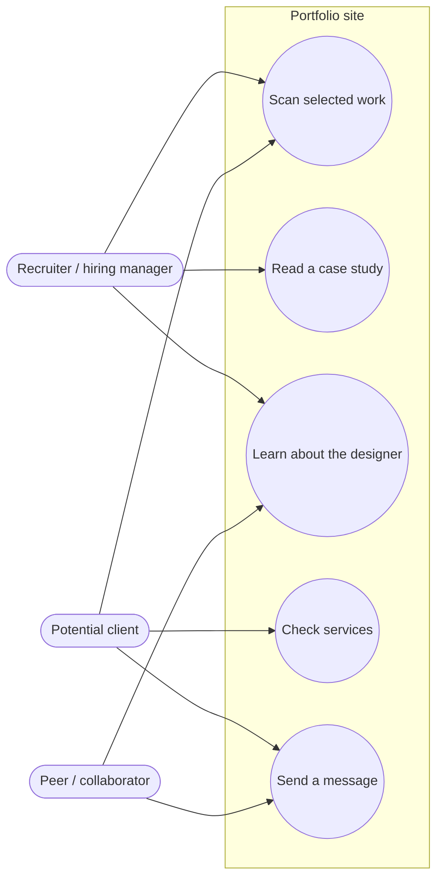
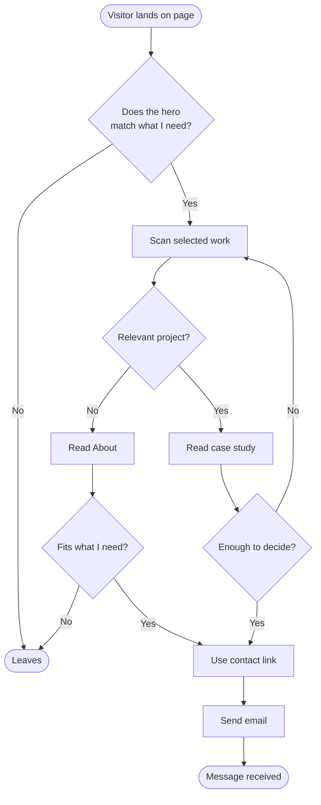

# Visitor flows

Planning diagrams for the portfolio. They are written in Mermaid, so they render on GitHub and in most Markdown viewers.

## Actors and use cases

Actors sit outside the system boundary. Use cases sit inside it. Each use case should map to a visible section of the page.

## Activity flow: from landing to contact

Only one start and one end. Each decision has labelled branches.

## Why this matters for the layout

- The **hero** must answer "what does this person do, and for whom?" in one glance, because the first branch is where most visitors leave.
- Every case study needs a clear path back to the **contact link**. The decision loop returns to "Work" or "Contact", never to a dead end.
- The contact link appears in the header navigation, at the end of each case study, and in the footer.
